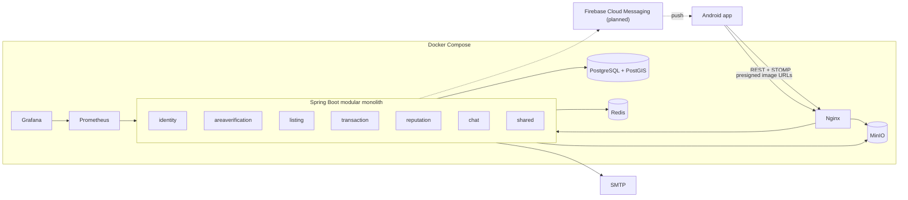

# Nearby backend

Backend for the hyperlocal second-hand marketplace. It is a Spring Boot 4.1 / Java 25 **modular monolith** (Spring Modulith) built on PostgreSQL + PostGIS, Redis, and MinIO.

## Requirements

- JDK 25
- Docker with Docker Compose

## Setup

```sh
cp .env.example .env
```

## Run

```sh
./gradlew bootRun      # compose.yaml starts PostGIS (5433), Redis and MinIO
```

The API runs on <http://localhost:8080>, with Swagger UI at <http://localhost:8080/swagger-ui.html>.

## Build

```sh
./gradlew build        # tests + format check + module verification + coverage gate
./gradlew format       # fixes formatting
```

## Architecture



## More

- [Local setup](docs/setup-local.md)
- [CI](docs/setup-ci.md)
- [Deployment](deploy/README.md)
- [Identity API](docs/api/identity-api.md)
