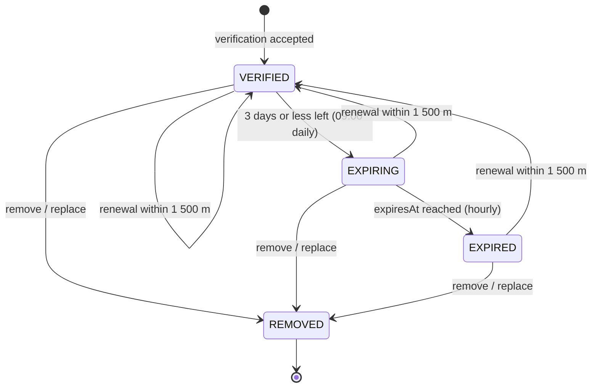
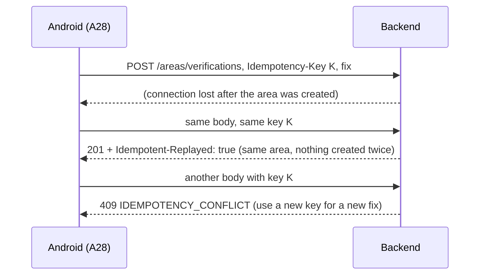

# Area API contract (Area Verification)

This contract covers SRS section 3.2: FR-AR-01 to FR-AR-10. FR-AR-11 (Play Integrity, R2) is not built. The `PLAY_INTEGRITY` signal code exists so it can be added later. The machine-readable contract is [`openapi.yml`](openapi.yml) (tag **Areas**); the Postman collection is [`docs/postman/nearby-area.postman_collection.json`](../postman/nearby-area.postman_collection.json). The trading gate (FR-ID-20) is in [`identity-api.md`](identity-api.md#f15-trading-gate-before-posting-chatting-or-making-an-offer-fr-id-20-uc-ls-01--uc-ch-01--uc-tx-01-a06-a10-a12) (flow F15).

Not built yet:
- `localityName` is always `null` until the SRS question of where the neighborhood name comes from is settled.
- Removing the `homeArea` profile field is Area Phase 6.

## Conventions

Same as [`identity-api.md` › Conventions](identity-api.md#conventions): base path `/api/v1`, bearer token, RFC 9457 problems with a stable `code`, and `Retry-After` on `429`.

- **Idempotency-Key.** It is required on the two GPS endpoints (`POST /areas/verifications`, `POST /areas/{areaId}/renewals`, SRS section 5.4). Use a new UUID per tap of "Xác minh tại đây", and reuse it only when retrying that same tap.
- **Coordinates.** No response ever contains coordinates (NFR-15). The app shows its own GPS position on the map, never a position from the server.

## Endpoint summary

| # | Method and path | Auth | Success | Requirement |
|---|---|---|---|---|
| 1 | `GET /areas/me` | USER | 200 | FR-AR-03, FR-AR-08 |
| 2 | `POST /areas/verifications` (Idempotency-Key) | USER | 201, or 200 when it renewed an area | FR-AR-01, 02, 05, 06, 10; UC-AR-01, UC-AR-03 |
| 3 | `POST /areas/{areaId}/renewals` (Idempotency-Key) | USER | 200 | FR-AR-04, 05, 06; UC-AR-02 |
| 4 | `PATCH /areas/{areaId}` | USER | 200 | UC-AR-01 step 9 |
| 5 | `PUT /areas/active` | USER | 200 | FR-AR-08; UC-AR-04 |
| 6 | `DELETE /areas/{areaId}` | USER | 204 | FR-AR-07; UC-AR-03 |
| — | `GET /users/me/trading-gate` | USER | 200 | FR-ID-20 (see identity contract) |

Every endpoint can return `401 UNAUTHENTICATED` and `400 VALIDATION_FAILED`. Another user's area always answers `404 AREA_NOT_FOUND` (FR-ID-18).

## Area lifecycle (SRS table `tab:sm-area`)



Any other move answers `409 AREA_STATUS_CONFLICT`. VERIFIED and EXPIRING areas unlock trading and count for the interaction range. An EXPIRED area does neither; its listings stay visible, but new chats and offers on them are refused until it is renewed (FR-AR-03). An area whose reminder never ran still goes through EXPIRING to EXPIRED at the hourly scan, so it is EXPIRED at most an hour after `expiresAt`.

Limits a user meets on these screens:

| Rule | Value (`app_parameters`) |
|---|---|
| Areas per user | 2 (`area.max_count`) |
| Validity | 30 days (`area.validity_days`), reminder 3 days before (`area.renewal_reminder_days`) |
| Renewal / "same area" distance | 1 500 m from the center (`area.renew_radius_m`) |
| Fix accepted | accuracy ≤ 100 m (`area.accuracy_threshold_m`), at most 120 s old (`area.max_fix_age_s`), OS mock flag off, implied speed since the last accepted fix ≤ 300 km/h (`area.max_speed_kmh`) |
| Attempts | 5 per day, rejected ones included (`area.max_attempts_per_day`) |
| Area changes | 3 added or replaced areas per 30 days (`area.max_changes_per_30d`) |
| Range levels | NEAR 2 km, MEDIUM 4 km, FAR 6 km (`area.range_levels_km`); new areas are MEDIUM |

---

## Business flows per screen

Rules for every flow: branch on `code`, never on `detail`. Show `guidance[].message` (Vietnamese, from the server) for rejected fixes. For `429`, disable the button and count down from `Retry-After`.

### FA1. Verify the first area (UC-AR-01; A01 → A27 → A28)

| Step | Screen / action | API | Success | Errors and UI |
|---|---|---|---|---|
| 1 | A27 "Thêm khu vực" (or the F15 call to action `NO_VALID_AREA`) | `GET /users/me/location-consent` | `granted = true`: go to step 2 | `granted = false`: consent dialog first (identity flow F9) |
| 2 | A28: explain why, ask the Android precise-location permission, get a fresh fix (lat, lng, accuracy, fix time, mock flag) and the device signals | — | — | Permission denied: explain and open Settings (E2). No fix: "Hãy bật vị trí và ra chỗ thoáng" (E3) |
| 3 | A28 "Xác minh tại đây": create `key = UUID` | `POST /areas/verifications` + `Idempotency-Key: key` | `201`: show the area and `expiresAt`; go to step 4. `200` (`renewal = true`): an existing area within 1 500 m was renewed; show its new `expiresAt` | `422 AREA_VERIFICATION_REJECTED`: show each `guidance[].message`; the attempt counts toward the 5 per day. `403 LOCATION_CONSENT_REQUIRED`: back to step 1. `409 AREA_LIMIT_REACHED`: run FA3 with `areaIds`. `429 AREA_RATE_LIMITED`: `reason = DAILY_ATTEMPTS` "Bạn đã thử 5 lần hôm nay" or `AREA_CHANGES` "Bạn đã thay đổi khu vực 3 lần trong 30 ngày", count down from `Retry-After`. Network error: resend **the same body with the same key** (A2) |
| 4 | Ask for a label ("Nhà", "Công ty"); the area is called "Khu vực {slot}" until then | `PATCH /areas/{id}` `{label}` | Show the name | `400 VALIDATION_FAILED`: 1–30 characters |

Keep between steps: `key` until the request gets any HTTP answer; the new area `id` for step 4. The first area is active with range MEDIUM, and the trading gate opens if consent and the account are fine (call F15 again).



### FA2. Renew an area (UC-AR-02; reminder → A28, or A27 "Gia hạn", or F15 `AREA_EXPIRED`)

| Step | Screen / action | API | Success | Errors and UI |
|---|---|---|---|---|
| 1 | Tap the reminder (sent 3 days before expiry) or "Gia hạn" on an area of `GET /areas/me` | — | Open A28 for that `areaId` | — |
| 2 | A28: fresh fix, new `key` | `POST /areas/{areaId}/renewals` + `Idempotency-Key` | `200`: `status = VERIFIED`, new `expiresAt` (now + 30 days) | `422 OUT_OF_RENEW_RADIUS`: "Bạn đang cách khu vực khoảng {distanceMeters} m"; offer "Thêm khu vực mới" (FA1) or "Thay thế khu vực này" (FA3). `422 AREA_VERIFICATION_REJECTED`: show `guidance`. `404 AREA_NOT_FOUND`: refresh the list. `409 AREA_STATUS_CONFLICT`: the area was removed; refresh. `429`: as in FA1 |

Show "Gia hạn" for areas with `status` `EXPIRING` or `EXPIRED`. It also works on `VERIFIED`.

### FA3. Third area: remove or replace (UC-AR-03; A27)

| Step | Screen / action | API | Success | Errors and UI |
|---|---|---|---|---|
| 1 | After `409 AREA_LIMIT_REACHED`, show the two areas from `areaIds` (or `GET /areas/me`) and ask "Xoá" or "Thay thế" | — | — | — |
| 2a | "Thay thế" area X: fresh fix, new `key` | `POST /areas/verifications` `{…fix, replaceAreaId: X}` | `201`: the new area takes X's slot; X is REMOVED and its listings are hidden | `409 AREA_HAS_OPEN_TRANSACTIONS`: "Hoàn tất hoặc huỷ giao dịch đang mở" with `listingIds`. `429 AREA_RATE_LIMITED` with `reason = AREA_CHANGES`. Others as in FA1 |
| 2b | "Xoá" area X | `DELETE /areas/{X}` | `204`; then run FA1 for the new place | `409 AREA_HAS_OPEN_TRANSACTIONS` as above. `409 AREA_STATUS_CONFLICT`: already removed |

Confirm before removing: "Các tin đăng thuộc khu vực này sẽ bị ẩn". If the removed area was active, the other valid area becomes active by itself.

### FA4. Choose the active area and range (UC-AR-04; A06 header, A27)

| Step | Screen / action | API | Success | Errors and UI |
|---|---|---|---|---|
| 1 | Area picker: list from `GET /areas/me`; only `VERIFIED` / `EXPIRING` areas are selectable | — | — | — |
| 2 | Pick an area and NEAR / MEDIUM / FAR | `PUT /areas/active` `{areaId, rangeLevel}` | `200`: the area has `active = true`; reload the feed | `400 INVALID_RANGE`. `409 AREA_STATUS_CONFLICT`: the area expired meanwhile; offer FA2 |

### FA5. Trading actions out of range (FR-AR-09; A10, A12)

These codes come from the Listing, Chat and Transaction endpoints (not built yet), which use this module's rules:

| Code | When | UI |
|---|---|---|
| `403 OUT_OF_RANGE` | Chat or offer on a listing outside the range of every valid area of the buyer | "Tin đăng nằm ngoài khu vực của bạn"; offer "Xác minh khu vực khác" (FA1) or a wider range (FA4) |
| `422 PIN_OUTSIDE_AREA` | Listing pin more than 1 500 m from the chosen area's center, or the area is not a valid area of the seller | Move the pin back inside the area circle |
| `409 LISTING_AREA_EXPIRED` | The seller's area of the listing is EXPIRED | "Người bán cần gia hạn khu vực" |

---

## 1. `GET /areas/me`

`200`, array in slot order. REMOVED areas are not listed.

```json
[
  {
    "id": "6f1d2c1e-8a8e-4c55-9d1a-3b0a3c7f4e21",
    "slot": 1,
    "label": "Nhà",
    "localityName": null,
    "status": "VERIFIED",
    "rangeLevel": "MEDIUM",
    "active": true,
    "verifiedAt": "2026-11-22T02:00:05Z",
    "expiresAt": "2026-12-22T02:00:05Z"
  }
]
```

| Field | Notes |
|---|---|
| `status` | `VERIFIED`, `EXPIRING`, `EXPIRED` |
| `rangeLevel` | `NEAR`, `MEDIUM`, `FAR` |
| `localityName` | Always `null` for now |

## 2. `POST /areas/verifications`

Headers: `Idempotency-Key: <UUID>` (required).

```json
{
  "latitude": 10.8700,
  "longitude": 106.8031,
  "accuracyMeters": 12.5,
  "fixTime": "2026-11-22T02:00:00Z",
  "mockLocation": false,
  "deviceSignals": { "emulator": false, "rooted": false, "developerOptions": true, "mockLocationApp": null },
  "appVersion": "1.0.0",
  "label": "Nhà",
  "replaceAreaId": null
}
```

| Field | Type | Required | Rules |
|---|---|---|---|
| `latitude` | number | yes | −90..90 |
| `longitude` | number | yes | −180..180 |
| `accuracyMeters` | number | yes | ≥ 0; over 100 is rejected (`LOW_ACCURACY`) |
| `fixTime` | ISO-8601 | yes | Older than 120 s is rejected (`STALE_FIX`) |
| `mockLocation` | boolean | yes | OS mock flag; `true` is rejected (`MOCK_LOCATION`) |
| `deviceSignals` | object | no | Each field `true`, `false` or `null` (unreadable). Stored for moderators; never rejects (FR-AR-05) |
| `appVersion` | string | no | ≤ 20 characters |
| `label` | string | no | 1–30 characters, not blank; default "Khu vực {slot}" |
| `replaceAreaId` | UUID | no | Replace this area of the caller (UC-AR-03) |

Response `201` (new area), or `200` when the fix was within 1 500 m of an existing area, which was renewed instead (UC-AR-01 A4):

```json
{ "area": { "id": "…", "slot": 1, "label": "Nhà", "status": "VERIFIED", "rangeLevel": "MEDIUM", "active": true, "…": "…" }, "renewal": false }
```

| Status | Code | When | Client action |
|---|---|---|---|
| 403 | `LOCATION_CONSENT_REQUIRED` | No PRECISE_LOCATION consent | Consent dialog (identity F9) |
| 403 | `ACCESS_DENIED` | Account not ACTIVE or without a verified phone | Should not happen for normal users; show the generic error |
| 404 | `AREA_NOT_FOUND` | `replaceAreaId` is not one of the caller's areas | Refresh `GET /areas/me` |
| 409 | `AREA_LIMIT_REACHED` | Already 2 areas and no `replaceAreaId`; `areaIds` lists them | FA3 |
| 409 | `AREA_HAS_OPEN_TRANSACTIONS` | The area to replace has listings with open transactions; `listingIds` | Show the listings to resolve |
| 409 | `AREA_STATUS_CONFLICT` | The area to replace is already removed | Refresh |
| 409 | `IDEMPOTENCY_CONFLICT` / `DUPLICATE_REQUEST` | Key reused with another body / first request still running | New key / wait and retry |
| 422 | `AREA_VERIFICATION_REJECTED` | A hard rule failed; `reasons` ⊆ {`MOCK_LOCATION`, `LOW_ACCURACY`, `STALE_FIX`, `IMPOSSIBLE_SPEED`}, `guidance[{reason, message}]`, `attemptId` | Show `guidance`; the attempt is stored and counted |
| 422 | `OUT_OF_RENEW_RADIUS` | Only when the fix renewed a nearby area; see §3 | — |
| 429 | `AREA_RATE_LIMITED` | `reason` `DAILY_ATTEMPTS` or `AREA_CHANGES`; `Retry-After` | Count down |

Rejection example:

```json
{
  "type": "https://nearby.uit.edu.vn/problems/area-verification-rejected",
  "title": "Unprocessable Content",
  "status": 422,
  "detail": "The location could not be verified.",
  "code": "AREA_VERIFICATION_REJECTED",
  "reasons": ["LOW_ACCURACY"],
  "guidance": [{ "reason": "LOW_ACCURACY", "message": "Tín hiệu GPS chưa đủ chính xác. Hãy ra chỗ thoáng hoặc ngoài trời rồi thử lại." }],
  "attemptId": "0b7c…"
}
```

Side effects:
- **Every evaluated attempt is stored.** Accepted or rejected, it goes to `area_verifications` with its reasons and device signals. The precise fix is purged after 90 days.
- **Events.** An accepted attempt publishes `AreaVerified`. A replacement also publishes `AreaRemoved` for the old area.
- **Refusals that are not attempts.** `403`, `404`, `409` and `429` refusals store nothing and don't use up the daily attempts.

## 3. `POST /areas/{areaId}/renewals`

Headers: `Idempotency-Key` (required). Body: the fields of §2 without `label` and `replaceAreaId`. Response `200` `{area, renewal: true}`, with the area VERIFIED and `expiresAt` = now + 30 days.

| Status | Code | When | Client action |
|---|---|---|---|
| 403 | `LOCATION_CONSENT_REQUIRED` / `ACCESS_DENIED` | As in §2 | As in §2 |
| 404 | `AREA_NOT_FOUND` | Not one of the caller's areas | Refresh |
| 409 | `AREA_STATUS_CONFLICT` | The area was removed | Refresh |
| 422 | `OUT_OF_RENEW_RADIUS` | The fix is more than 1 500 m from the center; `distanceMeters` rounded to 100 m, `guidance`, `attemptId` | Offer FA1 or FA3 |
| 422 | `AREA_VERIFICATION_REJECTED` | A hard rule failed (checked before the distance) | Show `guidance` |
| 429 | `AREA_RATE_LIMITED` | `reason = DAILY_ATTEMPTS` | Count down |

## 4. `PATCH /areas/{areaId}`

Body `{"label": "Công ty"}`: 1–30 characters, not blank. Response `200` with the area. Errors: `404 AREA_NOT_FOUND`, `409 AREA_STATUS_CONFLICT` (removed).

## 5. `PUT /areas/active`

Body `{"areaId": "…", "rangeLevel": "FAR"}`. Response `200` with the area (`active = true`). The previously active area becomes inactive.

| Status | Code | When |
|---|---|---|
| 400 | `INVALID_RANGE` | `rangeLevel` is not `NEAR`, `MEDIUM` or `FAR` |
| 404 | `AREA_NOT_FOUND` | Not one of the caller's areas |
| 409 | `AREA_STATUS_CONFLICT` | The area is EXPIRED or REMOVED; only a valid area can be active |

## 6. `DELETE /areas/{areaId}`

Response `204`. The area becomes REMOVED and its slot is free. If it was active, the user's other valid area becomes active. `AreaRemoved` is published, and Listing hides the area's ACTIVE listings with `hidden_reason = AREA_REMOVED`.

| Status | Code | When |
|---|---|---|
| 404 | `AREA_NOT_FOUND` | Not one of the caller's areas |
| 409 | `AREA_HAS_OPEN_TRANSACTIONS` | Listings of the area have OFFERED or ACCEPTED transactions; `listingIds` |
| 409 | `AREA_STATUS_CONFLICT` | Already removed |

---

## Domain events and module public API

| Event | Published when | Expected consumers |
|---|---|---|
| `areaverification.AreaVerified(userId, areaId, expiresAt, isRenewal)` | A verification or renewal is accepted | Listing (the area's listings take contacts again), Notification |
| `areaverification.AreaExpiring(userId, areaId, expiresAt)` | 09:00 daily, 3 days or less before expiry, once per period | Notification sends the renewal reminder that opens A28 |
| `areaverification.AreaExpired(userId, areaId, expiredAt)` | Hourly, at expiry | Notification; Listing and Transaction refuse new contacts through `InteractionRange.allowsNewContacts` |
| `areaverification.AreaRemoved(userId, areaId, removedAt)` | Remove or replace | Listing hides the area's listings |

Events carry ids and dates only, never coordinates. They go through the outbox, so consumers must handle the same event twice safely.

| Type | Kind | Used by |
|---|---|---|
| `InteractionRange` (`isWithinRange`, `requireWithinRange` → `403 OUT_OF_RANGE`, `allowsNewContacts`) | Facade | Chat (UC-CH-01), Transaction (UC-TX-01) |
| `ListingPinRule` (`isPinInsideArea`, `requirePinInsideArea` → `422 PIN_OUTSIDE_AREA`) | Facade | Listing (UC-LS-01) |
| `FeedArea.activeFeedArea(userId)` → `FeedCenter(areaId, center, radiusMeters)` | Facade | Discovery (FR-DC-01/04); the center is for server-side queries only |
| `AreaRemovalBlocker` | SPI | Implemented by Transaction for FR-AR-07 |
| `identity.TradingAreaStatus` | SPI implemented here | Identity's trading gate (FR-ID-20) |
| `identity.ProfileAreas` | SPI implemented here | `areas[]` on `GET /users/me` (FR-ID-12) and `localityName` on `GET /users/{userId}` (FR-ID-13) |

The range rule uses PostGIS `ST_DWithin` on the mean-Earth sphere (the same model as the 1 500 m renewal rule), against every VERIFIED or EXPIRING area of the buyer, each with its own range level.

## Background jobs

| Job | Schedule (Asia/Ho_Chi_Minh) | Effect |
|---|---|---|
| Renewal reminder (UC-SY-05) | 09:00 daily | VERIFIED → EXPIRING when 3 days or less are left; `AreaExpiring` |
| Expiry scan (UC-SY-05) | Hourly | VERIFIED or EXPIRING past `expiresAt` → EXPIRED; `AreaExpired` |
| Location retention (UC-SY-11) | 02:00 daily | Precise fixes older than 90 days (`location.retention_days`) are cleared; attempts older than 24 months (`area.attempt_retention_months`) are deleted |

When an account is anonymised (`AccountDeleted`), its areas are deleted and its precise fixes are cleared.
