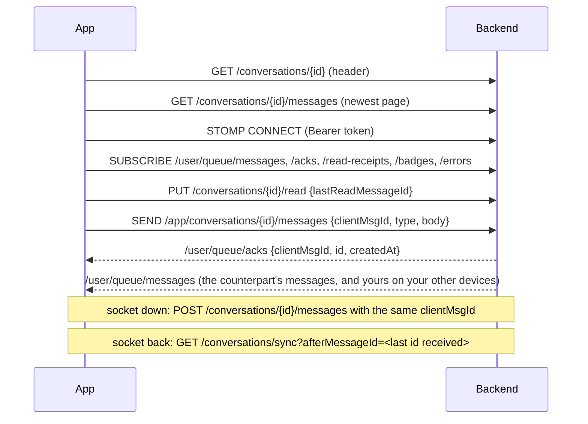

# Chat and Notification API contract

This is the contract of the `chat` module ("Chat + Notify"): 1-1 conversations about a listing (SRS 3.5, FR-CH) and in-app and push notifications (SRS 3.9, FR-NT). The STOMP frames are in [`chat-stomp.md`](chat-stomp.md). The plan, the readings of the SRS and the decisions are in [`../plans/chat-plan.md`](../plans/chat-plan.md).

## Scope

| Implemented (R1) | FR / UC |
|---|---|
| Open a conversation | FR-CH-01, UC-CH-01 |
| Send text, images and a meeting point; real time over STOMP, REST as the fallback and the source of truth; dedup by `clientMsgId`; 1 000 characters and 30 messages a minute | FR-CH-02..05, UC-CH-02..04 |
| Read state, unread counts, sync after a reconnect | FR-CH-06, FR-CH-07, UC-CH-05 |
| Readable after the sale, send lock when the listing is removed, a block or a sanction | FR-CH-11 |
| In-app notifications for the events that exist today, FCM push, preferences and quiet hours, dedup, list, unread badges | FR-NT-01..06, UC-NT-01, UC-NT-02, UC-SY-16 |
| Register the FCM token of the device (closes the FR-ID-03 gap) | FR-NT-02 |

| Not implemented | Why |
|---|---|
| System messages in a conversation (FR-CH-08) | The producers are Transaction and Payment. Chat has the SYSTEM message type and the internal poster; `Waits for other modules` below |
| Report a message (FR-CH-12) | The report table belongs to Moderation. Chat has the facade that returns the message and its 20 previous messages |
| Notifications of offers, appointments, payments, reviews, reports and disputes (FR-NT-01) | Same: each waits for its module |
| Mute and leave a conversation (FR-CH-09), scam warning banner (FR-CH-10) | R2. The columns `muted`, `left_at` and `risk_flag` exist and stay at their defaults |
| Keyword alerts and price drops (FR-NT-01, R2) | R2 |

## Conventions

| Topic | Rule |
|---|---|
| Base path | `/api/v1` |
| Authentication | Every endpoint needs `Authorization: Bearer <accessToken>`. Details in [`identity-api.md`](identity-api.md#conventions) |
| Errors | RFC 9457 `application/problem+json`; branch on `code`, never on `detail`. The STOMP error queue carries the same body plus `clientMsgId` |
| Pagination | The conversation list and the notification list use a cursor: `?cursor=<nextCursor>&limit=` (default 20, at most 100) and answer `{items, nextCursor, hasMore}`. A broken cursor is `400 INVALID_CURSOR`. Messages page by id (`before`, `after`), not by cursor |
| Time | ISO-8601 UTC instants. Quiet hours are local times in the user's `timeZone` |
| Unknown or foreign resources | A conversation, message or notification that is not yours is `404`, so its existence stays private |
| Rate limit | Messages: 30 a minute per user (`chat.rate_limit_per_min`), answered `429 CHAT_RATE_LIMITED` with `Retry-After` |
| Images | Short-lived signed links (`app.storage.presign-ttl`, 10 minutes). Do not cache them: fetch the message again |
| Missing query parameter | `400 VALIDATION_FAILED` with `errors[].field` (all modules, see "Breaking changes") |

## Endpoint summary

| # | Method and path | Access | Success | FR / screen |
|---|---|---|---|---|
| 1 | `POST /conversations` | USER | 201 new, 200 existing | FR-CH-01, A10 |
| 2 | `GET /conversations` | USER | 200 | FR-CH-06, A17 |
| 3 | `GET /conversations/{id}` | USER | 200 | FR-CH-11, A18 header |
| 4 | `GET /conversations/{id}/messages` | USER | 200 | FR-CH-07, A18 |
| 5 | `POST /conversations/{id}/messages` | USER | 201 new, 200 repeat | FR-CH-02..05, A18 |
| 6 | `PUT /conversations/{id}/read` | USER | 204 | FR-CH-06 |
| 7 | `GET /conversations/sync?afterMessageId=` | USER | 200 | FR-CH-07 |
| 8 | `POST /chat-images/upload-url` | USER | 200 | FR-CH-04, A18 |
| 9 | `POST /chat-images/{id}/complete` | USER | 202 | FR-CH-04 |
| 10 | `GET /chat-images/{id}` | USER | 200 | FR-CH-04 |
| 11 | `GET /notifications` | USER | 200 | FR-NT-05, A29 |
| 12 | `POST /notifications/{id}/read` | USER | 204 | FR-NT-05 |
| 13 | `POST /notifications/read-all` | USER | 204 | FR-NT-05 |
| 14 | `GET /users/me/badges` | USER | 200 | FR-NT-06 |
| 15 | `GET /users/me/notification-preferences` | USER | 200 | FR-NT-03, A30 |
| 16 | `PUT /users/me/notification-preferences` | USER | 200 | FR-NT-03, A30 |
| 17 | `PUT /devices/{deviceId}` | USER | 200 | FR-NT-02, FR-ID-03 |
| 18 | `DELETE /devices/{deviceId}` | USER | 204 | FR-NT-02 |
| S1 | STOMP `SEND /app/conversations/{id}/messages` | USER | ack on `/user/queue/acks` | FR-CH-02 |
| S2 | STOMP `SEND /app/conversations/{id}/read` | USER | receipt to the counterpart | FR-CH-06 |

## When can a member send? (FR-CH-11)

Reading a conversation is always allowed to its two members. Sending is allowed unless one of these holds. `GET /conversations/{id}` tells the app with `sendOpen` and shows `closedNotice`; the notice never says whether someone blocked the other.

| Situation | Can send? |
|---|---|
| Listing ACTIVE, RESERVED, SOLD, DELETED, hidden or expired | Yes (after SOLD both sides can still write) |
| Listing REMOVED by a moderator | No: `403 CONVERSATION_CLOSED` |
| Either member blocked the other | No: `403 CONVERSATION_CLOSED` |
| Either member is suspended, banned or deleted | No: `403 CONVERSATION_CLOSED` |

A **new** conversation needs more: the trading gate, the interaction range, no block, not your own listing and a listing that is ACTIVE or RESERVED (FR-CH-01). An existing conversation is always returned, whatever the listing state is now.

## Business flows per screen

### FC1. Open the chat from a listing (UC-CH-01; A10 "Chat" → A18)

| Step | Screen and action | API | Success | Errors and UI action |
|---|---|---|---|---|
| 1 | A10: tap "Chat" (shown when the listing detail says the action is allowed) | `POST /conversations` `{listingId}` | `201` or `200` with the conversation (`id`, `listing`, `counterpart`, `sendOpen`); open A18 with that `id` | `403 TRADING_GATE_FAILED`: show the unmet steps from `reasons[]` (account, phone, area, expired area, consent) and send the user to the matching screen. `403 OUT_OF_RANGE`: "Tin này ngoài khu vực của bạn". `403 CONTACT_NOT_ALLOWED`: neutral "Không thể liên hệ người dùng này". `404 LISTING_NOT_FOUND`: "Tin không còn". `409 INVALID_LISTING_STATE`: "Tin không còn khả dụng" (also your own listing, or an area that expired) |

Tapping twice returns the same `id`. Keep it as the conversation key.

### FC2. Chat screen (UC-CH-02, UC-CH-05, FR-CH-07; A18)



| Step | Screen and action | API | Success | Errors and UI action |
|---|---|---|---|---|
| 1 | Open A18 | `GET /conversations/{id}` then `GET /conversations/{id}/messages` | Header (listing, counterpart, `sendOpen`) and the newest page, oldest first | `404 CONVERSATION_NOT_FOUND`: back to A17 |
| 2 | Message list is on screen, newest message visible | `PUT /conversations/{id}/read` `{lastReadMessageId}` (or STOMP S2) | `204`; unread count is 0 on every device of the reader; the counterpart gets a read receipt | An older marker is ignored, so send it freely |
| 3 | Type and tap "Gửi" | STOMP S1, or `POST /conversations/{id}/messages` when the socket is down | Show "Đang gửi" with the generated `clientMsgId`; on the ack (or the REST answer) show "Đã gửi" and keep the server `id` | `422 MESSAGE_TOO_LONG` (counter over 1 000), `400 VALIDATION_FAILED` (empty), `429 CHAT_RATE_LIMITED` (wait `Retry-After`, then resend with the same `clientMsgId`), `403 CONVERSATION_CLOSED` (disable the input, show `closedNotice`), `404` (leave) |
| 4 | Timeout without an ack | Send again with the **same** `clientMsgId` | The stored message is returned; nothing is sent twice | None |
| 5 | Socket reconnects after a loss | `GET /conversations/sync?afterMessageId=<last id received>`; repeat while `hasMore` | Missed messages in id order, none missing or repeated | `400 INVALID_CURSOR`: reload the newest page of each conversation |
| 6 | The access token expires on the socket | Refresh the token, reconnect, resend the messages without an ack | Same as step 4 | CONNECT is refused with an expired token (UC-CH-02 E6) |

Data to keep: the `clientMsgId` of every unsent message, the highest message `id` received (the sync checkpoint, one per device, across conversations).

Show a message as read by the counterpart when `/user/queue/read-receipts` says `lastReadMessageId` is at or above its `id`.

### FC3. Send images (UC-CH-03, FR-CH-04; A18)

| Step | Action | API | Success | Errors and UI action |
|---|---|---|---|---|
| 1 | Pick 1 to 5 images (JPEG, PNG or WebP, at most 5 MB each; convert HEIC to JPEG first) | `POST /chat-images/upload-url` `{conversationId, contentType, sizeBytes}` per image | `uploadUrl`, `uploadMethod` PUT, `contentType` | `400 INVALID_IMAGE`: reject that image only. `404`: not a member |
| 2 | Upload the bytes | `PUT <uploadUrl>` with header `Content-Type: <contentType>` | `200` from storage | Network error: retry the PUT |
| 3 | Upload done | `POST /chat-images/{id}/complete` | `202` with the status (UPLOADING) | `400 INVALID_IMAGE`: nothing uploaded or over 5 MB (the file is deleted) |
| 4 | Wait | `GET /chat-images/{id}` every second or two | `READY` with `thumbnailUrl` and `url`, or `REJECTED` with `rejectReason` | REJECTED: show the retry button on that image |
| 5 | All images READY, tap send | `POST /conversations/{id}/messages` `{clientMsgId, type: "IMAGE", imageIds}` (or STOMP S1) | `201` with `images[]` | `422 IMAGE_INVALID`: an image is not yours, not READY, not of this conversation, or already sent; `400` for none or more than 5 |

The images lose their EXIF and GPS data. The counterpart can open an image only after it was sent; an image that was never sent is deleted after `upload.orphan_ttl_hours` (24 h).

### FC4. Share a meeting point (UC-CH-04, FR-CH-05; A13 → A18)

| Step | Action | API | Success | Errors |
|---|---|---|---|---|
| 1 | A13: pick a point on the map and a place name | `POST /conversations/{id}/messages` `{clientMsgId, type: "LOCATION", point: {latitude, longitude, placeName}}` (or STOMP S1) | `201` with `location` | `400 VALIDATION_FAILED` for a point outside Vietnam (latitude 8.0 to 23.5, longitude 102.0 to 117.5) or a place name of 0 or more than 100 characters |

The point is shown only to the two members. It never appears in a public API (BR-05).

### FC5. Conversation list and badges (UC-CH-05, FR-NT-06; A17, bottom navigation)

| Step | Action | API | Success | Notes |
|---|---|---|---|---|
| 1 | Open A17 | `GET /conversations?cursor=&limit=` | Conversations by latest activity: `listing` (title, status, cover), `counterpart` (name, avatar; a deleted account shows "Người dùng đã xoá"), `lastMessagePreview`, `unreadCount`, `sendOpen` | Pull to refresh = first page again |
| 2 | Bottom navigation | `GET /users/me/badges` | `{chatUnread, notificationUnread}` | Also pushed on `/user/queue/badges` after every change; read on one device updates the others |

### FC6. Notifications (UC-NT-01, FR-NT-05; A29)

| Step | Action | API | Success | Errors and UI action |
|---|---|---|---|---|
| 1 | Open A29 | `GET /notifications?cursor=&limit=` | Newest first; items with `read: false` are highlighted | `400 INVALID_CURSOR` |
| 2 | Tap an item | `POST /notifications/{id}/read`, then open `deepLink` | `204` | `404 NOTIFICATION_NOT_FOUND` |
| 3 | "Đánh dấu tất cả đã đọc" | `POST /notifications/read-all` | `204`; the badge is 0 | None |

Deep links have the form `app://<screen>/<id>`: `app://conversations/{id}`, `app://areas/{id}` (A28), `app://transactions/{id}`, `app://listings/{id}`, `app://users/{id}`, `app://disputes/{id}`, and without an id `app://home` and `app://account`. When the target no longer exists the screen answers 404: show "không còn khả dụng".

Notification types that exist now:

| `type` | `category` | When | Opens |
|---|---|---|---|
| `MESSAGE_RECEIVED` | CHAT | A message while you are not connected | `app://conversations/{id}` |
| `WELCOME` | SYSTEM | Right after registration | `app://home` |
| `AREA_EXPIRING`, `AREA_EXPIRED` | SYSTEM | Renewal reminder, expiry | `app://areas/{id}` |
| `SANCTION_SUSPENDED`, `SANCTION_BANNED`, `SANCTION_LIFTED` | SYSTEM | Account sanction, lifted | `app://account` |

The types for offers, appointments, payments, reviews and moderation (category TRADE and SYSTEM) are reserved and appear when their modules are built.

### FC7. Notification settings (UC-NT-02, FR-NT-03; A30)

| Step | Action | API | Success | Errors and UI action |
|---|---|---|---|---|
| 1 | Open A30 | `GET /users/me/notification-preferences` | The switches, quiet hours, `version`, `marketingConsentGranted` | A user who never saved gets the defaults |
| 2 | Save | `PUT /users/me/notification-preferences` with all fields and the `version` read | `200` with the new `version` | `400`: `systemPush` must stay true (show it as locked on); `marketingPush` needs the push marketing consent (`marketingConsentGranted`); quiet hours cannot start and end at the same time; unknown `timeZone`. `409 CONCURRENT_MODIFICATION`: reload and ask again |

Switches only filter the **push**; the in-app notification is always created. Quiet hours (`dndStart` inclusive, `dndEnd` exclusive, may cross midnight, for example 22:00 to 07:00) block every category's push.

### FC8. Register the device for push (FR-NT-02, FR-ID-03)

| Step | Action | API | Success | Notes |
|---|---|---|---|---|
| 1 | After login, and whenever `FirebaseMessaging` gives a new token | `PUT /devices/{deviceId}` `{fcmToken, platform, appVersion}` | `200` | `deviceId` is the installation id the app also sends at login. One device keeps one token; a new token replaces the old |
| 2 | Logout | The login flow already removes the token of that device; `DELETE /devices/{deviceId}` is available too | `204` | Safe to repeat |

The push shows the notification `title` and `body`; the `deepLink` is in the data payload (`data.deepLink`). A push is sent only when the user has no STOMP session open, the category switch is on, it is outside quiet hours and the device has a token.

## Endpoint details

### 1. `POST /conversations`

Request `{"listingId": "7d6f…"}`. Response `200` or `201`:

```json
{
  "id": "0b1c0f4e-6f0a-4a43-9d2f-8c4f3b0a1e55",
  "listing": { "id": "7d6f…", "title": "Ghế gỗ", "status": "ACTIVE", "priceVnd": 150000, "coverThumbnailUrl": "https://…" },
  "counterpart": { "id": "9a1e…", "displayName": "Nguyễn An", "avatarUrl": null, "deleted": false },
  "lastMessagePreview": null,
  "lastMessageAt": null,
  "unreadCount": 0,
  "sendOpen": true,
  "closedNotice": null,
  "sortAt": "2026-11-23T10:00:00Z"
}
```

`listing` and `counterpart` can be null if their rows are gone; `coverThumbnailUrl` and `avatarUrl` are null without an image. `lastMessagePreview` is the first 100 characters, `[Hình ảnh]` or `[Vị trí]`.

| Status | `code` | When |
|---|---|---|
| 400 | `VALIDATION_FAILED` | `listingId` missing |
| 403 | `TRADING_GATE_FAILED` | The gate is not open; `reasons[]` lists `ACCOUNT_RESTRICTED`, `PHONE_NOT_VERIFIED`, `NO_VALID_AREA`, `AREA_EXPIRED`, `CONSENT_MISSING` |
| 403 | `OUT_OF_RANGE` | The listing is outside the areas of the buyer |
| 403 | `CONTACT_NOT_ALLOWED` | Blocked either way; neutral text |
| 404 | `LISTING_NOT_FOUND` | Unknown, deleted or removed, and no earlier conversation |
| 409 | `INVALID_LISTING_STATE` | Your own listing, a listing that is not ACTIVE or RESERVED, or one of an area that expired |

Side effects: the first open adds 1 to the listing's `chatCount`.

### 5. `POST /conversations/{id}/messages`

The same body is used for STOMP S1.

```json
{ "clientMsgId": "5c1e…", "type": "TEXT", "body": "Còn hàng không bạn?" }
```

| Field | Type | Required | Rules |
|---|---|---|---|
| `clientMsgId` | UUID | yes | Generated by the app for every message. The same id from the same sender is stored once |
| `type` | `TEXT`, `IMAGE`, `LOCATION` | yes | Decides which of the next fields is read |
| `body` | string | for TEXT | 1 to 1 000 characters (`chat.max_message_chars`); control characters are removed, line breaks kept |
| `imageIds` | UUID list | for IMAGE | 1 to 5 different READY, unused images of this conversation uploaded by the sender |
| `point` | `{latitude, longitude, placeName}` | for LOCATION | Inside Vietnam; `placeName` 1 to 100 characters |

Response `201` (or `200` for a repeat):

```json
{
  "id": 1042,
  "conversationId": "0b1c…",
  "senderId": "3f2a…",
  "type": "TEXT",
  "body": "Còn hàng không bạn?",
  "clientMsgId": "5c1e…",
  "createdAt": "2026-11-23T10:00:03Z"
}
```

Exactly one of `body` (TEXT, SYSTEM), `images` (IMAGE: `[{url, thumbnailUrl, width, height}]`) and `location` (`{latitude, longitude, placeName}`) is present. `system` (`{kind, facts}`) and a null `senderId` and `clientMsgId` appear on SYSTEM messages. `id` grows with every message of every conversation: it is the sync checkpoint.

| Status | `code` | When |
|---|---|---|
| 400 | `VALIDATION_FAILED` | Empty text, no `type`, no or more than 5 images, a point outside Vietnam, a `clientMsgId` already used for a message of another conversation |
| 403 | `CONVERSATION_CLOSED` | See "When can a member send?" |
| 404 | `CONVERSATION_NOT_FOUND` | Unknown, or you are not a member |
| 422 | `MESSAGE_TOO_LONG` | More than 1 000 characters |
| 422 | `IMAGE_INVALID` | An image is not yours, not READY, of another conversation or already sent |
| 429 | `CHAT_RATE_LIMITED` | More than 30 messages in a minute; wait `Retry-After` seconds |

The checks run in this order: member, repeat of an earlier send, send lock, content, rate limit. A repeat is answered before the lock and the limit, so a retry always gets the stored message and costs nothing.

Side effects: the conversation's last message and the counterpart's unread count change; the message is pushed to both members on `/user/queue/messages`; an offline recipient gets a notification and a push; `MessageSent` is published.

### 4. `GET /conversations/{id}/messages?before=&after=&limit=`

Oldest first. No bound: the newest page (default 20, at most 100). `before=<id>`: the page before that id, for scrolling up. `after=<id>`: the page after that id. Both together are `400 VALIDATION_FAILED`.

### 6. `PUT /conversations/{id}/read`

Request `{"lastReadMessageId": 1042}` (not negative). `204`. A marker older than the stored one changes nothing; one above the newest message counts as the newest. The counterpart receives `{conversationId, readerId, lastReadMessageId}` on `/user/queue/read-receipts` and the reader's devices receive the new badge.

### 7. `GET /conversations/sync?afterMessageId=`

`afterMessageId` is the highest message id the device has received (0 on a fresh install). Response:

```json
{ "messages": [ { "id": 1043, "conversationId": "0b1c…", "type": "TEXT", "body": "…", "createdAt": "…" } ], "hasMore": false }
```

At most 200 messages per call, oldest first, across all the caller's conversations. While `hasMore` is true, call again with the last id returned. `400 INVALID_CURSOR` when the checkpoint is above the newest message (for example after a database restore): reload the newest page of each conversation. A missing parameter is `400 VALIDATION_FAILED`.

### 8-10. Chat images

`POST /chat-images/upload-url` `{conversationId, contentType, sizeBytes}` gives `{imageId, uploadUrl, uploadMethod: "PUT", contentType, expiresAt, maxSizeBytes}`. `POST /chat-images/{id}/complete` and `GET /chat-images/{id}` give `{imageId, status, rejectReason, thumbnailUrl, url}` where `status` is `UPLOADING`, `READY` or `REJECTED`, `rejectReason` is one of `TYPE_MISMATCH`, `UNSUPPORTED_TYPE`, `TOO_LARGE`, `DECODE_ERROR` (only when REJECTED) and the two links (320 px and 1080 px WebP) only when READY.

| Status | `code` | When |
|---|---|---|
| 400 | `INVALID_IMAGE` | Type is not JPEG, PNG or WebP, size is 0 or over 5 242 880 bytes, nothing was uploaded at complete |
| 404 | `CONVERSATION_NOT_FOUND` | upload-url: you are not a member |
| 404 | `IMAGE_NOT_FOUND` | Not your image; or, for the counterpart, not sent yet |

### 11-13. Notifications

`GET /notifications` gives `{items: [{id, category, type, title, body, deepLink, read, readAt, createdAt}], nextCursor, hasMore}`. `POST /notifications/{id}/read` is `404 NOTIFICATION_NOT_FOUND` for an unknown id or someone else's; marking a read item again changes nothing.

### 14. `GET /users/me/badges`

`{"chatUnread": 3, "notificationUnread": 1}`.

### 15-16. Notification preferences

```json
{
  "chatPush": true, "tradePush": true, "keywordAlertPush": true, "marketingPush": false, "systemPush": true,
  "dndEnabled": true, "dndStart": "22:00", "dndEnd": "07:00", "timeZone": "Asia/Ho_Chi_Minh",
  "marketingConsentGranted": false, "version": 0
}
```

`PUT` takes the same fields without `marketingConsentGranted` (all required). `keywordAlertPush` is stored but has no effect until R2.

### 17-18. Devices

`PUT /devices/{deviceId}` `{fcmToken, platform: "ANDROID" or "WEB", appVersion}` gives `{deviceId, platform}`. `400 VALIDATION_FAILED` for a blank or too long id (64) or token (255), an unknown platform, or an app version over 20 characters. A token already registered by another user or device moves to this one.

## Domain events and module public API

| Name | Kind | Published when | Consumed by |
|---|---|---|---|
| `MessageSent` | event | A member wrote a message (not SYSTEM) | Notification (push when offline); Moderation from R2 (scam screening) |
| `chat.ReportableMessages.contextOf(messageId, reporterId)` | facade | Moderation opens a report about a message | Moderation (register row CH-W2): the message plus the 20 before it; own message is `422 SELF_ACTION_NOT_ALLOWED`, a stranger `404`, a SYSTEM message `400` |
| `SystemMessagePoster`, `ConversationService.openForTrade` | internal | Transaction and Payment listeners (to be added inside chat) | CH-W1, CH-W5 |
| `ConversationService.isChatPartner` | internal query | Transaction implements its own SPI with it | CH-W4 |

Chat listens to `UserRegistered`, `UserSanctioned`, `SanctionLifted`, `AreaExpiring`, `AreaExpired`, `AccountDeleted` (notifications, welcome, cleanup), `DeviceSignedOut`, `AccountDeletionRequested` (device tokens).

## Waits for other modules

These are built with a stand-in and a hook, and listed in the register in `.claude/skills/nearby-feature-delivery/references/01-project-status.md`.

| ID | What waits | Waits for | Today | Hook |
|---|---|---|---|---|
| CH-W1 | One SYSTEM message per transaction step and per sale marked or denied (FR-CH-08) | Transaction, Payment | No system messages appear | `SystemMessagePoster` (dedup by event id) |
| CH-W2 | Report a message (FR-CH-12) | Moderation | No report item in the app | Facade `ReportableMessages` |
| CH-W3 | Staff read a dispute's chat (FR-MD-09) | Moderation | Not readable by staff | Shape only; Moderation builds `ConversationTranscripts` |
| CH-W4 | "Is a chat partner" for marking a sale (FR-LS-09 a) | Transaction | Not checked | `isChatPartner` |
| CH-W5 | An offer opens the conversation (UC-TX-01 step 7) | Transaction | Conversations open only from A10 | `openForTrade` |
| NT-W1 | Offer, sale marked, appointment, handover, receipt, completion notifications | Transaction | Not sent | Catalogue entries, `NotificationService`, `SourceEventId` |
| NT-W2 | Payment, refund and payout notifications | Payment | Not sent | Same |
| NT-W3 | Review invite and review published | Reputation | Not sent | Same |
| NT-W4 | Report result, dispute and appeal notifications | Moderation | Not sent | Same |
| NT-W5 | Push sent from the `worker` role | Platform | Sent by the single app after the commit | `PushGateway` port |

What the Android app should do about the open rows today: show the Chat button and the message screens; do not show a Report item or system messages yet; show no TRADE notification types.

## Runtime parameters

| Key | Default | Used for |
|---|---|---|
| `chat.max_message_chars` | 1000 | Longest text message |
| `chat.rate_limit_per_min` | 30 | Messages per user per minute |
| `notification.retention_months` | 6 | How long a notification is kept |
| `image.max_bytes` | 5242880 | Largest chat image |
| `upload.orphan_ttl_hours` | 24 | How long an unsent chat image is kept |

Configuration (not runtime): `app.websocket.relay.*` (RabbitMQ STOMP relay; `WS_RELAY_ENABLED=false` for one instance), `app.push.fcm.*` (`FCM_CREDENTIALS`, empty means pushes are skipped). See [`../setup-local.md`](../setup-local.md).

## Background jobs

| Job | When | What |
|---|---|---|
| `ChatImageCleanupJob` (UC-SY-15) | Every hour | Deletes chat images that no message used after `upload.orphan_ttl_hours`, with their files |
| `NotificationRetentionJob` | Daily at 03:00 (Asia/Ho_Chi_Minh) | Deletes notifications older than `notification.retention_months` |
| Presence renewal | Every 30 seconds | Each replica renews the Redis presence of its own STOMP sessions |
| Conversation retention | When an account is anonymised (`AccountDeleted`) | A conversation is kept while either account exists, with a deleted author shown as "Người dùng đã xoá"; when both accounts are deleted it is deleted with its messages, meeting points and image files (SRS ch4 retention) |

## Breaking changes

- A missing required query parameter (for example `GET /conversations/sync` without `afterMessageId`) now answers `400` with `code: VALIDATION_FAILED` and `errors[].field`, for every endpoint of every module. Before, it was a bare Spring 400 without `code`.
