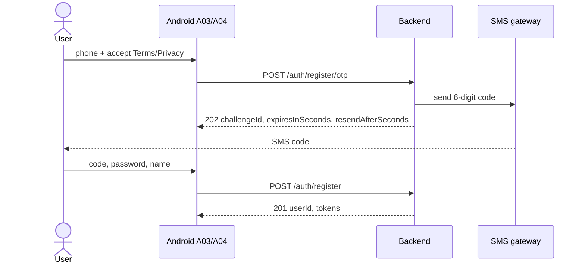
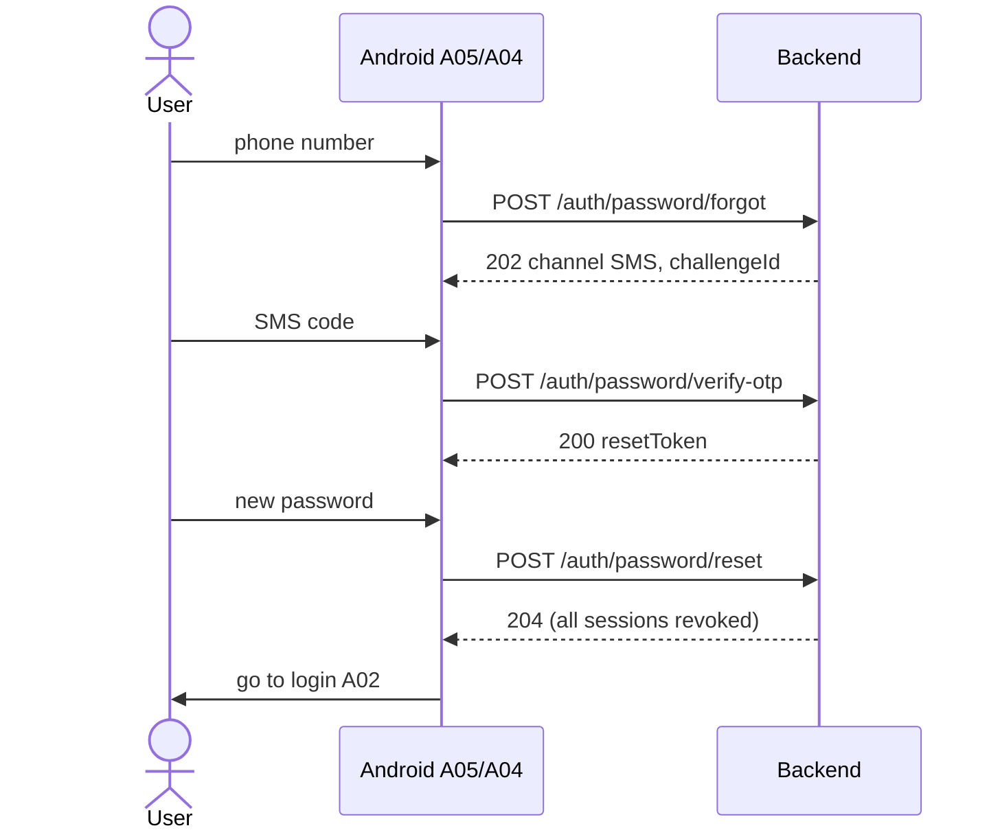
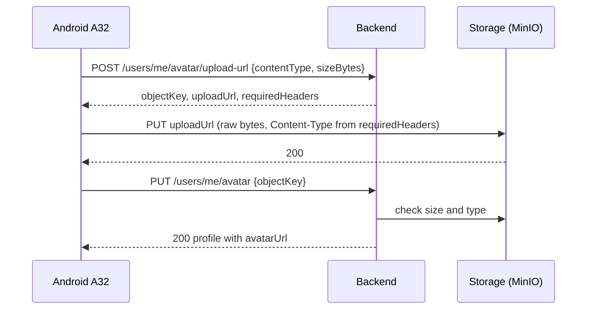

# Identity API contract (Accounts and Authorization)

This contract covers SRS section 3.1: FR-ID-01 to FR-ID-05, FR-ID-07 to FR-ID-09, FR-ID-11, FR-ID-13 to FR-ID-16, FR-ID-19 and FR-ID-20. The machine-readable contract is [`openapi.yml`](openapi.yml), generated from the code (`/v3/api-docs.yaml` on a running app); Swagger UI is at `/swagger-ui.html`. Screen-by-screen usage is in [Business flows per screen](#business-flows-per-screen). A Postman collection is in [`docs/postman/`](../postman/).

## Conventions

| Topic | Rule |
|---|---|
| Base path | `/api/v1` |
| Body | JSON (`application/json`); timestamps are ISO-8601 in UTC |
| Auth | `Authorization: Bearer <accessToken>` on every endpoint except `/api/v1/auth/**` and `GET /api/v1/users/{userId}` |
| Errors | RFC 9457 `application/problem+json` with a stable `code` field. Validation errors add `errors: [{field, message}]` |
| Rate limits | `429` (`RATE_LIMITED`, `OTP_RATE_LIMITED` or `LOGIN_LOCKED`) with a `Retry-After` header in seconds |
| Pagination | Cursor based: `{items, nextCursor, hasMore}`. Pass `nextCursor` back as `cursor` |
| Idempotency | Commands marked "Idempotency-Key" need the header `Idempotency-Key: <UUID>` (a new UUID per user action, reused only for retries of that action). The same key with the same body within 24 h returns the original response with the header `Idempotent-Replayed: true`, and the command is not run again. The same key with another body: `409 IDEMPOTENCY_CONFLICT`. While the first request is still running: `409 DUPLICATE_REQUEST`. Missing or not a UUID: `400 IDEMPOTENCY_KEY_REQUIRED`. Only `2xx` and `422` responses are kept; after any other error the key is released and can be retried |

Error example:

```json
{
  "type": "https://nearby.uit.edu.vn/problems/weak-password",
  "title": "Bad Request",
  "status": 400,
  "detail": "Password must be at least 8 characters. Password must contain both letters and digits.",
  "code": "WEAK_PASSWORD",
  "violations": [
    { "rule": "MIN_LENGTH", "message": "Password must be at least 8 characters." },
    { "rule": "LETTER_AND_DIGIT", "message": "Password must contain both letters and digits." }
  ]
}
```

## Endpoint summary

| # | Method and path | Auth | Success | Requirement |
|---|---|---|---|---|
| 1 | `POST /auth/register/otp` | public | 202 | FR-ID-02 |
| 2 | `POST /auth/register` | public | 201 | FR-ID-01 |
| 3 | `POST /auth/login` | public | 200 | FR-ID-03 |
| 4 | `POST /auth/refresh` | public | 200 | FR-ID-04 |
| 5 | `POST /auth/logout` | public | 204 | FR-ID-05 |
| 6 | `POST /auth/password/forgot` | public | 202 | FR-ID-07 |
| 7 | `POST /auth/password/verify-otp` | public | 200 | FR-ID-07 |
| 8 | `POST /auth/password/reset` | public | 204 | FR-ID-07 |
| 9 | `POST /auth/email-verification` | public | 204 | FR-ID-09 |
| 10 | `PUT /users/me/password` | USER | 204 | FR-ID-08 |
| 11 | `PUT /users/me/email` | USER | 202 | FR-ID-09 |
| 12 | `POST /users/me/email/verification` | USER | 202 | FR-ID-09 |
| 13 | `GET /users/me` | USER | 200 | FR-ID-11, FR-ID-12 |
| 14 | `PUT /users/me` | USER | 200 | FR-ID-11 |
| 15 | `POST /users/me/avatar/upload-url` | USER | 200 | FR-ID-11 |
| 16 | `PUT /users/me/avatar` | USER | 200 | FR-ID-11 |
| 17 | `DELETE /users/me/avatar` | USER | 204 | FR-ID-11 |
| 18 | `GET /users/me/location-consent` | USER | 200 | FR-ID-15 |
| 19 | `PUT /users/me/location-consent` | USER | 200 | FR-ID-15 |
| 20 | `DELETE /users/me/location-consent` | USER | 204 | FR-ID-15 |
| 21 | `GET /users/me/consents` | USER | 200 | FR-ID-15 |
| 22 | `PUT /users/me/consents/push-marketing` | USER | 200 | FR-ID-15 |
| 23 | `DELETE /users/me/consents/push-marketing` | USER | 204 | FR-ID-15 |
| 24 | `DELETE /users/me` | USER | 202 | FR-ID-16 |
| 25 | `GET /users/{userId}` | public | 200 | FR-ID-13 |
| 26 | `GET /users/me/blocks` | USER | 200 | FR-ID-14 |
| 27 | `PUT /users/me/blocks/{userId}` | USER | 204 | FR-ID-14 |
| 28 | `DELETE /users/me/blocks/{userId}` | USER | 204 | FR-ID-14 |
| 29 | `GET /admin/users` | ADMIN | 200 | FR-ID-19 |
| 30 | `GET /admin/users/{userId}` | ADMIN | 200 | FR-ID-19 |
| 31 | `POST /admin/users/{userId}/lock` | ADMIN | 200 | FR-ID-19 |
| 32 | `POST /admin/users/{userId}/suspend` | ADMIN | 200 | FR-ID-19 |
| 33 | `POST /admin/users/{userId}/unlock` | ADMIN | 200 | FR-ID-19 |
| 34 | `GET /users/me/trading-gate` | USER | 200 | FR-ID-20 |

Every path in the table is relative to `/api/v1`. Every authenticated endpoint can also return `401 UNAUTHENTICATED`, and every endpoint can return `400 VALIDATION_FAILED`. The per-endpoint tables below list only the other errors.

## Account lifecycle

```
send SMS code --> register with the code --> ACTIVE (phone verified)
ACTIVE --admin suspend (1/7/30 days)--> SUSPENDED --end reached or admin unlock--> ACTIVE
ACTIVE or SUSPENDED --admin lock--> BANNED --admin unlock--> ACTIVE
ACTIVE --DELETE /users/me--> PENDING_DELETION --login within 7 days--> ACTIVE
PENDING_DELETION --7 days later--> DELETED (anonymised)
```

Any other move answers `409 ACCOUNT_STATUS_CONFLICT`. A suspension ends by itself: the `SuspensionExpiryJob` runs every 5 minutes, and logging in after the end lifts it at once.

The phone number (E.164, `+84` and 9 digits) is the login identifier. An email address is optional; it can be used to log in and to reset the password only once it is verified.

## One-time SMS codes (FR-ID-02)

| Rule | Value (`app_parameters`) |
|---|---|
| Code | 6 digits, stored in Redis only as an HMAC-SHA256 hash |
| Lifetime | `otp.ttl_s` = 300 seconds |
| Wrong entries per code | `otp.max_attempts` = 5; the 5th wrong entry cancels the code |
| Resend interval (same number, same purpose) | `otp.resend_s` = 60 seconds |
| Codes per number per day | `otp.max_per_day` = 5 |

| Status | Code | When |
|---|---|---|
| 400 | `INVALID_PHONE` | Not a Vietnamese mobile number |
| 422 | `OTP_INVALID` | Wrong code; `remainingAttempts` tells how many tries are left |
| 422 | `OTP_EXPIRED` | The code expired, was already used or never existed |
| 422 | `OTP_ATTEMPTS_EXCEEDED` | Too many wrong codes; request a new one |
| 429 | `OTP_RATE_LIMITED` | Inside the resend interval or over the daily quota; `Retry-After` header |
| 503 | `SMS_UNAVAILABLE` | The SMS gateway failed; the quota is not used up |

---

## Business flows per screen

Each flow says which screen calls which endpoint, in what order, what to keep between steps and how the UI handles every error code. Screen codes are from SRS table 61 (Android `A01`–`A37`) and the admin list (`W01`–`W16`). Endpoint details are in sections 1–5; the machine-readable contract is [`openapi.yml`](openapi.yml).

Rules that hold for every flow:

- Branch on the problem `code`, never on `detail` (the text may change). Show `detail` only as a fallback for unknown codes.
- `400 VALIDATION_FAILED`: show each `errors[].message` under the field named by `errors[].field`.
- `429`: disable the button and count down from the `Retry-After` header (seconds).
- `401 UNAUTHENTICATED` on an authenticated call: run flow F4 (refresh) once, then retry; if refresh fails, go to A02.
- Keep the access token in memory and the refresh token in encrypted storage (Android: DataStore with Tink or EncryptedSharedPreferences; web: `sessionStorage`). Never log tokens.

### Android app (users)

#### F1. App start: restore the session

| Step | Screen / action | API | Success | Errors and UI |
|---|---|---|---|---|
| 1 | Splash: a refresh token is stored | `POST /auth/refresh` | Keep the new pair, go to A06 | `401 INVALID_REFRESH_TOKEN` / `REFRESH_TOKEN_REUSED`: clear tokens, go to A02. `403 ACCOUNT_SUSPENDED` / `ACCOUNT_BANNED`: go to A36 with `reason`, `suspendedUntil` |
| 2 | Splash: no token | — | Go to A02 (or A03 on first launch) | — |
| 3 | Load the user | `GET /users/me` | Cache the profile for A31 | `401`: back to step 1 once |

#### F2. Register with a phone number (UC-AC-01, A03 → A04)

| Step | Screen / action | API | Success | Errors and UI |
|---|---|---|---|---|
| 1 | A03: enter the phone, tick Terms and Privacy (links show versions `consent.terms_version` / `privacy_version`), optional marketing switch, tap "Gửi mã" | `POST /auth/register/otp` `{phone}` | Keep `challengeId`; start a countdown of `resendAfterSeconds` for "Gửi lại mã"; go to A04 | `400 INVALID_PHONE` under the phone field. `429 OTP_RATE_LIMITED`: countdown from `Retry-After` (also hit after 5 codes a day). `503 SMS_UNAVAILABLE`: "Không gửi được SMS, thử lại sau" |
| 2 | A04: enter the 6 digits, password, display name, tap "Đăng ký" | `POST /auth/register` `{phone, challengeId, otp, password, displayName, termsVersion, privacyVersion, pushMarketing}` | `201`: store `tokens`, go to A01 (location permission intro) then A06 | `422 OTP_INVALID`: "Mã sai, còn {remainingAttempts} lần". `422 OTP_EXPIRED` / `OTP_ATTEMPTS_EXCEEDED`: back to step 1. `400 WEAK_PASSWORD`: list `violations[].message`. `422 CONSENT_REQUIRED`: re-show the checkboxes. `409 POLICY_VERSION_STALE`: reload versions, ask again. `409 PHONE_ALREADY_REGISTERED`: offer "Đăng nhập" or "Quên mật khẩu". `429 RATE_LIMITED`: countdown |
| 3 | A04: "Gửi lại mã" after the countdown | `POST /auth/register/otp` | Replace `challengeId` (the old code is dead) | Same as step 1 |

Keep between steps: `phone` (normalised display), `challengeId`, the policy versions shown. The code lives `expiresInSeconds` (300 s).



#### F3. Log in (UC-AC-02, A02)

| Step | Screen / action | API | Success | Errors and UI |
|---|---|---|---|---|
| 1 | A02: phone or verified email + password | `POST /auth/login` `{identifier, password}` | Store the pair, go to A06. A pending account deletion is cancelled silently; you may toast "Đã huỷ yêu cầu xoá tài khoản" if the user had asked for it on this device | `401 INVALID_CREDENTIALS`: one generic message (never say which part is wrong). `429 LOGIN_LOCKED`: countdown. `403 ACCOUNT_SUSPENDED`: A36 with `reason` and `suspendedUntil`. `403 ACCOUNT_BANNED`: A36 with `reason` and the appeal entry. `400 INVALID_PHONE`: "Số điện thoại hoặc email không hợp lệ" |

#### F4. Keep the session alive (UC-AC-03, every screen)

| Step | Trigger | API | Success | Errors and UI |
|---|---|---|---|---|
| 1 | Any call returns `401`, or the access token expires within 60 s | `POST /auth/refresh` `{refreshToken}` | Store **both** new tokens, retry the original call once | `401 REFRESH_TOKEN_REUSED`: the session was stolen or used twice; clear tokens, go to A02 with "Phiên đăng nhập đã hết hạn". `401 INVALID_REFRESH_TOKEN`: same. `403 ACCOUNT_*`: A36 |

Only one refresh may run at a time: queue the other calls behind it. Two parallel refreshes with the same token look like theft and revoke the whole session. A sanction or account deletion makes the old access token fail with `401` at once.

#### F5. Forgot password (UC-AC-05, A05 → A04 → new password)

| Step | Screen / action | API | Success | Errors and UI |
|---|---|---|---|---|
| 1 | A05: phone number | `POST /auth/password/forgot` `{identifier}` | `202 {channel: "SMS", challengeId, ...}`: go to A04. The answer is the same whether or not the number has an account; say "Nếu số này đã đăng ký, bạn sẽ nhận được mã" | `400 INVALID_PHONE`, `429 OTP_RATE_LIMITED`, `503 SMS_UNAVAILABLE` as in F2 |
| 2 | A04: 6-digit code | `POST /auth/password/verify-otp` `{challengeId, phone, otp}` | Keep `resetToken` (until `expiresAt`), show the new-password form | `422 OTP_INVALID` / `OTP_EXPIRED` / `OTP_ATTEMPTS_EXCEEDED` as in F2 |
| 3 | New password | `POST /auth/password/reset` `{resetToken, newPassword}` | `204`: every session is logged out; go to A02 with a success toast | `400 WEAK_PASSWORD`: show `violations`, the token is still valid. `422 RESET_TOKEN_INVALID`: restart at step 1 |
| 1' | A05: verified email instead | `POST /auth/password/forgot` | `202 {channel: "EMAIL"}`: "Kiểm tra hộp thư" | — |
| 2' | User opens the link `nearby://reset-password?token=...` | — | Read `token` from the deep link, show the new-password form | — |
| 3' | New password | `POST /auth/password/reset` with the link token | Same as step 3; the email also becomes verified | Same as step 3 |



#### F6. Log out (UC-AC-03, A31 / A33)

| Step | Screen / action | API | Success | Errors and UI |
|---|---|---|---|---|
| 1 | "Đăng xuất" | `POST /auth/logout` `{refreshToken, fcmToken}` | Always `204`: clear tokens and cached user data, go to A02. Send the FCM token so this phone stops getting pushes | None: treat network errors as logged out locally |

#### F7. My profile and editing it (UC-AC-09/10, A31 → A32)

| Step | Screen / action | API | Success | Errors and UI |
|---|---|---|---|---|
| 1 | A31: open | `GET /users/me` | Show name, avatar, phone with the verified badge, email state. If `displayNameChangeAllowedAt` is present, disable the name field in A32 with "Có thể đổi tên sau {date}" | — |
| 2 | A32: save name and default area | `PUT /users/me` `{displayName, homeArea}` | Update the cache with the returned profile | `422 NAME_CHANGE_TOO_SOON`: show `nextAllowedAt`. `400 VALIDATION_FAILED` per field. Send the current name unchanged when only the area changes |
| 3 | A32: pick a photo | `POST /users/me/avatar/upload-url` `{contentType, sizeBytes}` | Keep `objectKey`, `uploadUrl`, `requiredHeaders` | `400 INVALID_IMAGE`: "Chỉ nhận JPEG, PNG, WebP tối đa 5 MB" (check before calling) |
| 4 | Upload the bytes | `PUT {uploadUrl}` directly to storage, **no bearer token**, every header of `requiredHeaders` exactly | `200` from storage | `403 SignatureDoesNotMatch` (XML): the `Content-Type` differs from `requiredHeaders` or the URL was changed; restart at step 3. URL expired (`expiresAt`): restart at step 3 |
| 5 | Confirm | `PUT /users/me/avatar` `{objectKey}` | Profile with the new `avatarUrl` | `400 AVATAR_NOT_UPLOADED` / `INVALID_IMAGE` / `INVALID_AVATAR_KEY`: restart at step 3 |
| 6 | Remove the photo | `DELETE /users/me/avatar` | `204` | — |

`avatarUrl` is a presigned GET URL valid for `MINIO_PRESIGN_TTL` (10 min): do not store it, reload the profile instead. Image caching libraries must key the cache on `objectKey`-like stable parts, not the full signed URL.



#### F8. Settings: password and email (UC-AC-06/07, A33)

| Step | Screen / action | API | Success | Errors and UI |
|---|---|---|---|---|
| 1 | Change password | `PUT /users/me/password` `{currentPassword, newPassword}` | `204`: other devices are logged out, this one stays | `400 CURRENT_PASSWORD_INVALID` under the current field. `400 PASSWORD_REUSED`, `400 WEAK_PASSWORD` (`violations`) under the new field |
| 2 | Add or change email | `PUT /users/me/email` `{email}` | `202`: "Đã gửi email xác minh tới {email}"; show "chưa xác minh" | `409 EMAIL_UNAVAILABLE`: generic "Không dùng được email này" |
| 3 | User opens `nearby://verify-email?token=...` | `POST /auth/email-verification` `{token}` | `204`: refresh `GET /users/me`, show "đã xác minh" | `422 INVALID_VERIFICATION_TOKEN`: offer "Gửi lại email" |
| 4 | "Gửi lại email" | `POST /users/me/email/verification` | `202` | `400 EMAIL_NOT_SET`. Extra requests past 5 per hour are dropped silently, so do not promise delivery |

#### F9. Consents (UC-AC-13, A01 / A33)

| Step | Screen / action | API | Success | Errors and UI |
|---|---|---|---|---|
| 1 | A01 before the first GPS collection | `GET /users/me/location-consent` | Show the terms of `currentTermsVersion` if `granted` is false | — |
| 2 | Accept | `PUT /users/me/location-consent` `{termsVersion}` | Then ask the Android location permission | `400 OUTDATED_TERMS_VERSION`: reload step 1 |
| 3 | A33: withdraw location | `DELETE /users/me/location-consent` | `204`: stop collecting GPS; trading actions will be blocked by the trading gate (FR-ID-20) | — |
| 4 | A33: consent list | `GET /users/me/consents` | One switch per purpose; TERMS/PRIVACY read-only | — |
| 5 | A33: marketing switch on / off | `PUT` / `DELETE /users/me/consents/push-marketing` | `200` / `204` | — |

#### F10. Public profile and blocking (UC-AC-11/12, A11 / A18 / A33)

| Step | Screen / action | API | Success | Errors and UI |
|---|---|---|---|---|
| 1 | A11: open someone's profile (also works logged out) | `GET /users/{userId}` | Name, avatar, phone badge, join date. `deleted: true`: show "Người dùng đã xoá", hide contact and block actions | `404 USER_NOT_FOUND` |
| 2 | A11 / A18: "Chặn" with a confirm dialog | `PUT /users/me/blocks/{userId}` | `204`: hide their listings and chats locally; never tell the other user | `400 CANNOT_BLOCK_SELF` (hide the button on your own profile). `404` |
| 3 | A33: blocked list | `GET /users/me/blocks?cursor=` | Paged list, "Tải thêm" with `nextCursor` | `400 INVALID_CURSOR`: reload from the start |
| 4 | "Bỏ chặn" | `DELETE /users/me/blocks/{userId}` | `204`, remove the row | — |

Contacting a user who blocked you (chat, offer) will answer `403 CONTACT_NOT_ALLOWED` in those modules: show "Không thể liên hệ người dùng này" without mentioning a block.

#### F11. Delete my account (UC-AC-14, A33)

| Step | Screen / action | API | Success | Errors and UI |
|---|---|---|---|---|
| 1 | Explain the 7-day grace period, ask for the password | `DELETE /users/me` `{password}` | `202 {status, deleteAfter}`: clear tokens, show "Tài khoản sẽ bị xoá vào {deleteAfter}. Đăng nhập lại trước thời điểm này để huỷ", go to A02 | `400 CURRENT_PASSWORD_INVALID`. `409 ACCOUNT_DELETION_BLOCKED`: list `blockers` (open transactions, held payments) with links. `409 ACCOUNT_STATUS_CONFLICT`: the account is sanctioned; show A36 |

#### F12. Sanction notice (UC-SP-04, A36)

Reached from F1, F3 or F4 on `403 ACCOUNT_SUSPENDED` / `ACCOUNT_BANNED`. Show the `reason`, for a suspension the end `suspendedUntil` in local time with "Đăng nhập lại sau thời điểm này", and the appeal entry (appeals arrive with the moderation module). After `suspendedUntil`, logging in works again (the backend lifts the suspension itself).

#### F15. Trading gate before posting, chatting or making an offer (FR-ID-20, UC-LS-01 / UC-CH-01 / UC-TX-01; A06, A10, A12)

The gate opens only when all four conditions of FR-ID-20 hold: an ACTIVE account, a verified phone, at least one VERIFIED or EXPIRING area, and PRECISE_LOCATION consent. Ask for it before showing the trading screens, so the user sees what is missing instead of an error.

| Step | Screen / action | API | Success | Errors and UI |
|---|---|---|---|---|
| 1 | A06 tab "Đăng tin", or A10 buttons "Chat" / "Đề nghị mua" (UC-LS-01 step 1) | `GET /users/me/trading-gate` | `open = true`: continue to A12, A18 or A20. `open = false`: show one call to action per item of `failures` (table below) instead of the action | `401`: run F4 |
| 2 | The user completes the step (consent, area verification or renewal) | The API of that step | Call step 1 again; it is never cached, so the new state shows at once | -- |
| 3 | Any trading action that is still refused | (the action's own endpoint) | -- | `403 TRADING_GATE_FAILED` with `reasons` (same values as `failures`): handle as in step 1 |

| `failures` value | Meaning | Call to action |
|---|---|---|
| `ACCOUNT_RESTRICTED` | The account is not ACTIVE (suspended, banned, pending deletion) | Show A36 (F12) |
| `PHONE_NOT_VERIFIED` | No verified phone number | Verify the phone (only accounts without a phone, such as admins) |
| `NO_VALID_AREA` | No area at all | "Xác minh khu vực" → A27 / A28 (area flows) |
| `AREA_EXPIRED` | The user has areas, but all are EXPIRED | "Gia hạn khu vực" → A28 for the expired area |
| `CONSENT_MISSING` | No PRECISE_LOCATION consent for the current terms | Consent dialog (F9 step 1–2) |

Several values can come together; they are listed in FR-ID-20 order. Show them all, or at least the first one.

### Admin web console

#### F13. Admin log in (UC-AD-01, W01)

| Step | Screen / action | API | Success | Errors and UI |
|---|---|---|---|---|
| 1 | Email + password | `POST /auth/login` | Decode the access token payload: `roles` must contain `ADMIN`, else call logout and show "Tài khoản này không có quyền quản trị" | As in F3 |
| 2 | Session | `POST /auth/refresh` | As F4, refresh token in `sessionStorage` | As F4 |

#### F14. Find a user and act (UC-AD-04/07, W05 → W06)

| Step | Screen / action | API | Success | Errors and UI |
|---|---|---|---|---|
| 1 | W05: search box (phone, email, name) and status filter | `GET /admin/users?query=&status=&limit=20` | Table, "Tải thêm" with `nextCursor` | `400 INVALID_CURSOR`: reload |
| 2 | W05: open a row | `GET /admin/users/{userId}` | User 360 with status, `suspendedUntil`, `deletionRequestedAt` | `404 USER_NOT_FOUND` |
| 3 | W06: "Tạm khoá" 1/7/30 days + reason | `POST /admin/users/{id}/suspend` `{days, reason}` | Replace the account with the response | `400 INVALID_SUSPENSION_PERIOD`. `403 CANNOT_LOCK_OWN_ACCOUNT` / `CANNOT_LOCK_ADMIN` (hide the actions for admins). `409 ACCOUNT_STATUS_CONFLICT` / `CONCURRENT_MODIFICATION`: refetch step 2 |
| 4 | W06: "Cấm vĩnh viễn" + reason + type the name | `POST /admin/users/{id}/lock` `{reason}` | Same | Same |
| 5 | W06: "Gỡ" + reason | `POST /admin/users/{id}/unlock` `{reason}` | Same | `409 ACCOUNT_STATUS_CONFLICT`: refetch |

Which actions to show: `ACTIVE` → suspend, ban; `SUSPENDED` → ban, lift; `BANNED` → lift; `PENDING_DELETION`, `DELETED`, any `ADMIN` account and your own account → none.

---

## 1. Authentication

### 1.1 `POST /auth/register/otp`

Request: `{ "phone": "0912 345 678" }`. Accepted forms: `0912345678`, `84912345678`, `+84912345678`, with spaces, dots or dashes.

Response `202`:

```json
{ "challengeId": "5c1f...", "expiresInSeconds": 300, "resendAfterSeconds": 60 }
```

The code is sent even when the number already has an account; that is revealed only after the code is verified.

### 1.2 `POST /auth/register`

Request:

```json
{
  "phone": "0912345678",
  "challengeId": "5c1f...",
  "otp": "123456",
  "password": "Secret123",
  "displayName": "An Nguyen",
  "termsVersion": "1.0",
  "privacyVersion": "1.0",
  "pushMarketing": false
}
```

| Field | Rules |
|---|---|
| `phone` | Required, the number the code was sent to |
| `challengeId` / `otp` | From step 1.1 and the SMS; `otp` is 6 digits |
| `password` | Required, max 200. At least 8 characters, at most 72 UTF-8 bytes, letters and digits |
| `displayName` | Required, 2-30 characters, trimmed |
| `termsVersion` / `privacyVersion` | Versions of the Terms and the Privacy Policy the user accepted (`consent.terms_version`, `consent.privacy_version`). Leave out when not accepted |
| `pushMarketing` | Optional consent to marketing pushes |

Response `201`: the account is `ACTIVE`, TERMS and PRIVACY consents are recorded with their versions, `UserRegistered` is published and a session starts.

```json
{
  "userId": "1b0c...",
  "phone": "+84912345678",
  "tokens": { "tokenType": "Bearer", "accessToken": "...", "accessTokenExpiresAt": "...", "refreshToken": "...", "refreshTokenExpiresAt": "..." }
}
```

| Status | Code | When |
|---|---|---|
| 400 | `WEAK_PASSWORD` | The password breaks the policy. `violations` lists every rule that failed |
| 409 | `POLICY_VERSION_STALE` | The accepted versions are not the current ones |
| 409 | `PHONE_ALREADY_REGISTERED` | The number already has an account (reported only after a correct code). Log in or reset the password |
| 422 | `CONSENT_REQUIRED` | Terms or Privacy Policy not accepted |
| 422 | `OTP_*` | See the OTP table |
| 429 | `RATE_LIMITED` | More than `auth.registrations_per_hour_per_ip` registrations from the same IP |

### 1.3 `POST /auth/login`

Request: `{ "identifier": "0912345678", "password": "..." }`. `identifier` is the phone number or a **verified** email address.

Response `200`:

```json
{
  "tokenType": "Bearer",
  "accessToken": "eyJhbGciOiJIUzI1NiJ9...",
  "accessTokenExpiresAt": "2026-10-18T03:15:00Z",
  "refreshToken": "q3nV...",
  "refreshTokenExpiresAt": "2026-11-17T03:00:00Z"
}
```

The access token is an HS256 JWT. `sub` is the user id, `roles` holds `USER` or `ADMIN` and `sid` is the session (refresh token family). It lives 15 minutes (`JWT_ACCESS_TTL`), and the refresh token lives 30 days (`JWT_REFRESH_TTL`). Only the SHA-256 hash of the refresh token is stored.

| Status | Code | When |
|---|---|---|
| 401 | `INVALID_CREDENTIALS` | Unknown identifier, unverified email or wrong password. The response is identical byte for byte |
| 403 | `ACCOUNT_SUSPENDED` | Correct password, but the account is suspended. The body adds `suspendedUntil` and, when the admin gave one, `reason` |
| 403 | `ACCOUNT_BANNED` | Correct password, but the account is banned. The body adds `reason` |
| 429 | `LOGIN_LOCKED` | `auth.login_max_failed_attempts` (5) failures for the identifier, or `auth.login_max_failed_per_ip` (20) failures from the client IP, within `auth.login_lockout_minutes` (15). The block holds even for the right password until the window ends. A successful login resets the identifier counter only |

Logging in to an account in `PENDING_DELETION` cancels the deletion (`AccountDeletionCancelled`).

```json
{ "status": 403, "code": "ACCOUNT_SUSPENDED", "reason": "Spam", "suspendedUntil": "2026-10-25T03:00:00Z" }
```

### 1.4 `POST /auth/refresh`

Request: `{ "refreshToken": "..." }`. Response `200` with the same body as login. The presented token is revoked (`ROTATED`), and the new one belongs to the same family.

| Status | Code | When |
|---|---|---|
| 401 | `INVALID_REFRESH_TOKEN` | Unknown or expired token. The client must log in again |
| 401 | `REFRESH_TOKEN_REUSED` | The token was already rotated or revoked. **The whole family is revoked** (`REUSE_DETECTED`) and a security event is logged |
| 403 | `ACCOUNT_SUSPENDED` / `ACCOUNT_BANNED` | The account was sanctioned |

### 1.5 `POST /auth/logout`

Request: `{ "refreshToken": "...", "fcmToken": "..." }`. `fcmToken` (optional, max 300) is this device's push token: after the logout the device gets no more pushes (`DeviceSignedOut`, the Notify module deletes the `device_tokens` row). The response is always `204`. An unknown, expired or already revoked token counts as already logged out.

### 1.6 `POST /auth/password/forgot`

Request: `{ "identifier": "0912345678" }` or `{ "identifier": "an@example.com" }`. Response `202`:

- Phone number: `{ "channel": "SMS", "challengeId": "...", "expiresInSeconds": 300, "resendAfterSeconds": 60 }`. The answer and the OTP limits are the same whether or not the number has an account; the SMS is sent only when it has one.
- Email: `{ "channel": "EMAIL" }`. A link `${PASSWORD_RESET_URL}?token=...` (valid `auth.password_reset_ttl_minutes`, 30 minutes) is sent only when an account **verified** that address.

### 1.7 `POST /auth/password/verify-otp`

Request: `{ "challengeId": "...", "phone": "0912345678", "otp": "123456" }`. Response `200`: `{ "resetToken": "...", "expiresAt": "..." }`. Errors: see the OTP table.

### 1.8 `POST /auth/password/reset`

Request: `{ "resetToken": "...", "newPassword": "NewSecret456" }`. `resetToken` comes from step 1.7 or from the email link. Response `204`. The password is changed, `password_changed_at` is set and every refresh token of the account is revoked (`PASSWORD_CHANGED`). Using the email link also verifies that email.

| Status | Code | When |
|---|---|---|
| 400 | `WEAK_PASSWORD` | The new password breaks the policy. The token stays valid |
| 422 | `RESET_TOKEN_INVALID` | The token is unknown, already used or expired |

### 1.9 `POST /auth/email-verification`

Request: `{ "token": "<token from the link>" }`. Response `204`. The token is single use, valid for `auth.email_verification_ttl_hours` (24 hours), and only for the address it was sent to.

| Status | Code | When |
|---|---|---|
| 422 | `INVALID_VERIFICATION_TOKEN` | Unknown, used or expired token, or the account changed its email since. Request a new link |

### 1.10 `PUT /users/me/password`

Request: `{ "currentPassword": "...", "newPassword": "..." }`. Response `204`. Every other session is logged out (`PASSWORD_CHANGED`); the session of the access token used for the request stays.

| Status | Code | When |
|---|---|---|
| 400 | `CURRENT_PASSWORD_INVALID` | Wrong current password |
| 400 | `PASSWORD_REUSED` | The new password equals the current one |
| 400 | `WEAK_PASSWORD` | The new password breaks the policy |

### 1.11 `PUT /users/me/email` and `POST /users/me/email/verification`

`PUT` request: `{ "email": "an@example.com" }`. Response `202`. The address is stored lowercase and unverified, and a link `${EMAIL_VERIFICATION_URL}?token=...` is emailed. Saving the address that is already verified changes nothing. `POST .../verification` sends a new link to the unverified address. Each address gets at most `auth.account_emails_per_hour` (5) emails per hour; extra requests are dropped silently.

| Status | Code | When |
|---|---|---|
| 400 | `EMAIL_NOT_SET` | Resend requested, but the account has no email |
| 409 | `EMAIL_UNAVAILABLE` | Another account uses the address (generic message) |

### 1.12 `DELETE /users/me`

Request: `{ "password": "..." }`. Response `202`:

```json
{ "status": "PENDING_DELETION", "deleteAfter": "2026-10-25T03:00:00Z" }
```

Every session is revoked (`ACCOUNT_DELETION`), push tokens are dropped and `AccountDeletionRequested` is published. Logging in before `deleteAfter` (`account.deletion_grace_days`, 7) cancels the deletion. After it, the daily job anonymises the account: phone, email, home area and avatar are removed, the name becomes "Người dùng đã xoá", the status becomes `DELETED` and `AccountDeleted` is published. The phone number can then register again. Consent records are kept as evidence.

| Status | Code | When |
|---|---|---|
| 400 | `CURRENT_PASSWORD_INVALID` | Wrong password |
| 403 | `CANNOT_DELETE_ADMIN` | Admin accounts cannot be deleted |
| 409 | `ACCOUNT_DELETION_BLOCKED` | Another module still holds an obligation (open transaction, payment held, payout pending). `blockers` lists them |
| 409 | `ACCOUNT_STATUS_CONFLICT` | The account is not `ACTIVE` |

---

## 2. Profile (`/users/me`)

### 2.1 `GET /users/me`

Response `200`:

```json
{
  "id": "1b0c...",
  "phone": "+84912345678",
  "email": "an.nguyen@example.com",
  "displayName": "An Nguyen",
  "avatarUrl": "https://storage.example.com/nearby-images/avatars/1b0c.../7f3e....jpg?X-Amz-...",
  "role": "USER",
  "status": "ACTIVE",
  "homeArea": { "latitude": 10.87, "longitude": 106.803 },
  "phoneVerified": true,
  "emailVerified": true,
  "createdAt": "2026-10-18T03:00:00Z",
  "displayNameChangeAllowedAt": "2026-11-17T03:00:00Z"
}
```

`avatarUrl` is a presigned GET URL that is valid for `MINIO_PRESIGN_TTL`. `displayNameChangeAllowedAt` is set only while the display name cannot be changed yet. When a field has no value (`email`, `avatarUrl`, `homeArea`, `displayNameChangeAllowedAt`), it is left out of the response.

### 2.2 `PUT /users/me`

Request:

```json
{ "displayName": "An Nguyen", "homeArea": { "latitude": 10.870149, "longitude": 106.803151 } }
```

Response `200` with the profile. The display name can change once every `profile.display_name_change_days` (30) days; sending the current name again is not a change, and the first change is always allowed. `homeArea` is the default area. It is optional: leave it out or send `null` to clear it. Latitude must be in [-90, 90] and longitude in [-180, 180]. The point is **rounded to 3 decimals** (about 110 m) before it is stored, so a precise home location is never saved.

| Status | Code | When |
|---|---|---|
| 422 | `NAME_CHANGE_TOO_SOON` | The name changed less than 30 days ago. `nextAllowedAt` says when it can change again |

Removing EXIF data from avatars (UC-SY-10) and the banned-word filter (R2) are not built yet.

### 2.3 Avatar upload (two steps, the image never passes through the backend)

**Step 1:** `POST /users/me/avatar/upload-url`

```json
{ "contentType": "image/jpeg", "sizeBytes": 204800 }
```

Response `200`:

```json
{
  "objectKey": "avatars/1b0c.../7f3e....jpg",
  "uploadUrl": "https://storage.example.com/nearby-images/avatars/...?X-Amz-...",
  "method": "PUT",
  "expiresAt": "2026-10-18T03:10:00Z",
  "requiredHeaders": { "Content-Type": "image/jpeg" }
}
```

`contentType` may also be `image/jpg` or `image/pjpeg` (sent by some phones for `.jpg` files) and is case-insensitive; the backend turns it into `image/jpeg`, so the object key ends with `.jpg` and `requiredHeaders` says `image/jpeg`.

The client then sends `PUT uploadUrl` with the raw image bytes and every header listed in `requiredHeaders`, **exactly** as given: `Content-Type` is part of the signature, so a different value (another type, or an added `; charset=...`) fails with `SignatureDoesNotMatch`.

**Step 2:** `PUT /users/me/avatar` with `{ "objectKey": "avatars/1b0c.../7f3e....jpg" }`. Response `200` with the profile. The backend reads the stored object's real size and type, and any previous avatar is deleted after the change is committed.

| Status | Code | When |
|---|---|---|
| 400 | `INVALID_IMAGE` | Step 1 or 2: the type is not JPEG, PNG or WebP, or the size is over `image.max_bytes` (5 MB). In step 2 the uploaded object is deleted |
| 400 | `INVALID_AVATAR_KEY` | Step 2: the key was not issued for the caller's avatar |
| 400 | `AVATAR_NOT_UPLOADED` | Step 2: nothing was uploaded under the key |

### 2.4 `DELETE /users/me/avatar`

Response `204`. The image is deleted from storage.

### 2.5 `GET /users/{userId}` (public profile, no token needed)

```json
{ "id": "1b0c...", "displayName": "An Nguyen", "avatarUrl": "https://...", "phoneVerified": true,
  "joinedAt": "2026-10-18T03:00:00Z", "deleted": false }
```

Never contains coordinates, phone or email. A deleted account answers `deleted: true` with the name "Người dùng đã xoá" and no avatar. Rank, score, area labels, listings and reviews are added when the Reputation, Area and Listing modules exist. `404 USER_NOT_FOUND` for an unknown id.

---

## 3. Location consent (`/users/me/location-consent`)

Consent must be given before the first precise location is collected. Area verification and listings with a precise location check it through the `identity.LocationConsents` facade, which throws `403 LOCATION_CONSENT_REQUIRED` when there is no consent.

### 3.1 `GET`

Response `200`:

```json
{
  "granted": true,
  "termsVersion": "1.0",
  "consentedAt": "2026-10-18T03:00:00Z",
  "currentTermsVersion": "1.0"
}
```

`granted` is true only while the consent is active **and** was given to `currentTermsVersion` (`consent.location_terms_version`). When the terms version is raised, every user must consent again. A withdrawn consent also has `withdrawnAt`.

### 3.2 `PUT`

Request: `{ "termsVersion": "1.0" }`. Response `200` with the consent. The backend records the time and the terms version.

| Status | Code | When |
|---|---|---|
| 400 | `OUTDATED_TERMS_VERSION` | `termsVersion` is not the current version |

### 3.3 `DELETE`

Response `204`. This publishes `LocationConsentWithdrawn`, after which modules stop collecting precise locations. Data already collected is kept and then disposed of per SRS section 4.4. Withdrawing when there is no active consent does nothing.

### 3.4 `GET /users/me/consents`

Response `200`: one item per purpose (`TERMS`, `PRIVACY`, `PRECISE_LOCATION`, `PUSH_MARKETING`), each from the newest `user_consents` row:

```json
[{ "purpose": "PUSH_MARKETING", "granted": false, "policyVersion": "1.0",
   "grantedAt": "2026-10-18T03:00:00Z", "withdrawnAt": "2026-10-20T03:00:00Z" }]
```

### 3.5 `PUT` / `DELETE /users/me/consents/push-marketing`

`PUT` grants consent to marketing pushes under the current Privacy Policy version and answers `200` with the item; granting again while active keeps the existing row. `DELETE` withdraws it and answers `204`.

---

## 5. Blocks (`/users/me/blocks`)

Blocking is silent: the blocked user is never told. Other modules check `identity.UserBlocks.isBlockedEitherWay(a, b)` before a chat, message or offer and answer `CONTACT_NOT_ALLOWED` without revealing the block; listings of blocked users are hidden with `blockedEitherWay(userId)`.

| Endpoint | Result |
|---|---|
| `GET /users/me/blocks?cursor=&limit=` | `200`, cursor page of `{ userId, displayName, avatarUrl, blockedAt }`, newest first |
| `PUT /users/me/blocks/{userId}` | `204`; blocking again changes nothing |
| `DELETE /users/me/blocks/{userId}` | `204`; unblocking someone not blocked changes nothing |

| Status | Code | When |
|---|---|---|
| 400 | `CANNOT_BLOCK_SELF` | The id is the caller's own |
| 404 | `USER_NOT_FOUND` | Unknown or deleted account |

## 6. Trading gate (`/users/me/trading-gate`)

### 6.1 `GET /users/me/trading-gate`

Returns whether the caller may post listings, open chats and make offers (FR-ID-20), and which conditions are missing. It is computed on every call from the account, the consent and the areas, so it is never stale.

Response `200`:

```json
{
  "open": false,
  "failures": ["AREA_EXPIRED", "CONSENT_MISSING"]
}
```

| Field | Type | Notes |
|---|---|---|
| `open` | boolean | `true` exactly when `failures` is empty |
| `failures` | array of enum | Any of `ACCOUNT_RESTRICTED`, `PHONE_NOT_VERIFIED`, `NO_VALID_AREA`, `AREA_EXPIRED`, `CONSENT_MISSING`, in that order; empty when open |

Errors: only `401 UNAUTHENTICATED`.

Listing, Chat and Transaction check the same gate on their own endpoints and answer `403 TRADING_GATE_FAILED` with `reasons` holding the same values.

---

## 4. Admin: users (`/admin/users`, ADMIN only)

A `USER` token gets `403 ACCESS_DENIED`, and the attempt is logged with the user id and path (FR-ID-04). The first admin account is created on startup from `ADMIN_EMAIL` / `ADMIN_PASSWORD`.

### 4.1 `GET /admin/users?query=&status=&cursor=&limit=`

| Param | Meaning |
|---|---|
| `query` | Optional. Case-insensitive substring match on phone, email or display name. `%` and `_` are matched literally |
| `status` | Optional. `ACTIVE`, `SUSPENDED`, `BANNED`, `PENDING_DELETION` or `DELETED` |
| `cursor` | Optional. The `nextCursor` value from the previous page |
| `limit` | Optional. Default 20, max 100 |

Results are sorted newest first. Response `200`:

```json
{
  "items": [
    {
      "id": "1b0c...",
      "phone": "+84912345678",
      "email": "an.nguyen@example.com",
      "displayName": "An Nguyen",
      "role": "USER",
      "status": "SUSPENDED",
      "suspendedUntil": "2026-10-25T03:00:00Z",
      "phoneVerified": true,
      "emailVerified": true,
      "createdAt": "2026-10-18T03:00:00Z",
      "updatedAt": "2026-10-18T03:00:00Z"
    }
  ],
  "nextCursor": "MTc2MDc1NjQwMDAwMHwxYjBj...",
  "hasMore": true
}
```

| Status | Code | When |
|---|---|---|
| 400 | `INVALID_CURSOR` | The cursor is malformed |

### 4.2 `GET /admin/users/{userId}`

Response `200` with one item in the format above. `suspendedUntil` and `deletionRequestedAt` appear only when set.

| Status | Code | When |
|---|---|---|
| 404 | `USER_NOT_FOUND` | No account has that id |

### 4.3 `POST /admin/users/{userId}/lock`

Bans the account for good. Request: `{ "reason": "Repeated scam reports" }`. The reason is required, max 200 characters. Response `200` with the user, whose `status` is now `BANNED`. An `ACTIVE` or `SUSPENDED` account can be banned.

In one transaction, the backend:

1. sets the account to `BANNED`, so it cannot log in or refresh;
2. revokes every refresh token of the account;
3. writes `audit_log` (`USER_LOCKED`, actor, target, reason). If that write fails, the lock is rejected (FR-MD-04);
4. publishes `UserSanctioned(type BAN)` through the outbox.

After the commit, access tokens issued before the lock are rejected right away (`401`), not only when they expire, and the account's push tokens are dropped.

| Status | Code | When |
|---|---|---|
| 403 | `CANNOT_LOCK_OWN_ACCOUNT` | The admin tries to lock their own account |
| 403 | `CANNOT_LOCK_ADMIN` | The target is another admin |
| 404 | `USER_NOT_FOUND` | No account has that id |
| 409 | `ACCOUNT_STATUS_CONFLICT` | The account is already banned, pending deletion or deleted |
| 409 | `CONCURRENT_MODIFICATION` | Another admin changed the same account at the same time |

### 4.4 `POST /admin/users/{userId}/suspend`

Request: `{ "days": 7, "reason": "Spam" }`. `days` is 1, 7 or 30 (FR-MD-05). Response `200` with the user: `status` is `SUSPENDED` and `suspendedUntil` is now plus `days`. Like a ban, it revokes every session, rejects old access tokens at once, writes `audit_log` (`USER_SUSPENDED`, reason and end) and publishes `UserSanctioned(type SUSPENSION, until)`. The account becomes `ACTIVE` again by itself when the suspension ends.

| Status | Code | When |
|---|---|---|
| 400 | `INVALID_SUSPENSION_PERIOD` | `days` is not 1, 7 or 30 |
| 403 | `CANNOT_LOCK_OWN_ACCOUNT` / `CANNOT_LOCK_ADMIN` | Same as for a ban |
| 404 | `USER_NOT_FOUND` | No account has that id |
| 409 | `ACCOUNT_STATUS_CONFLICT` | The account is not `ACTIVE` |

### 4.5 `POST /admin/users/{userId}/unlock`

Lifts a suspension or a ban. Request: `{ "reason": "Appeal accepted" }`. Response `200`; the status goes back to `ACTIVE`. The backend writes `audit_log` (`USER_UNLOCKED`) and publishes `SanctionLifted`.

| Status | Code | When |
|---|---|---|
| 404 | `USER_NOT_FOUND` | No account has that id |
| 409 | `ACCOUNT_STATUS_CONFLICT` | The account is neither suspended nor banned |

---

## Domain events (module public API)

| Event | Published when | Expected consumers |
|---|---|---|
| `identity.UserRegistered(userId, registeredAt)` | A phone-verified account is created | Reputation creates the starting snapshot (50 / NEW) |
| `identity.UserSanctioned(userId, type, until, sanctionedAt)` | An admin suspends (`SUSPENSION`, with `until`) or bans (`BAN`) an account | Listing hides the user's listings. Transaction cancels open transactions without penalizing the other party. Notify drops the push tokens |
| `identity.SanctionLifted(userId, liftedAt)` | A suspension ends or an admin unlocks the account | Listing may show the hidden listings again |
| `identity.AccountDeletionRequested(userId, deleteAfter)` | The user deletes the account | Notify drops the push tokens |
| `identity.AccountDeletionCancelled(userId, cancelledAt)` | The user logs in during the grace period | -- |
| `identity.AccountDeleted(userId, deletedAt)` | The account was anonymised | Every module anonymises the personal data it keeps |
| `identity.DeviceSignedOut(userId, fcmToken)` | Logout with a push token | Notify deletes that `device_tokens` row |
| `identity.LocationConsentWithdrawn(userId, withdrawnAt)` | The user withdraws location consent | Area Verification stops collecting locations |

These events go through the `event_publication` outbox, so consumers must be idempotent. The Notify consumer (`chat.infrastructure.DeviceTokenCleanup`) exists; the Listing, Transaction and Reputation consumers belong to those modules and are not built yet.

Other modules can also implement `identity.AccountDeletionBlocker` to list obligations that block an account deletion.

Module public API for the trading gate (FR-ID-20):

| Type | Kind | Used by |
|---|---|---|
| `identity.TradingGate` (`evaluate`, `requireOpen`) | Facade | Listing (UC-LS-01), Chat (UC-CH-01), Transaction (UC-TX-01) call `requireOpen(userId)`, which throws `403 TRADING_GATE_FAILED` with `reasons` |
| `identity.TradingAreaStatus` (`standingOf(userId)` → `VALID`, `ONLY_EXPIRED`, `NONE`) | SPI | Implemented by Area Verification. Identity defines it so the two modules don't depend on each other |
| `identity.AccountStanding` | Facade | Area Verification: an ACTIVE account with a verified phone (FR-AR-01 precondition) |

## Runtime parameters (`app_parameters`)

| Key | Default | Used by |
|---|---|---|
| `auth.login_max_failed_attempts` | 5 | Login lockout |
| `auth.login_lockout_minutes` | 15 | Login lockout window |
| `auth.login_max_failed_per_ip` | 20 | Login lockout per client IP |
| `account.deletion_grace_days` | 7 | Days a deletion can still be cancelled by logging in |
| `profile.display_name_change_days` | 30 | Minimum days between two display name changes |
| `auth.registrations_per_hour_per_ip` | 10 | Registration rate limit |
| `auth.account_emails_per_hour` | 5 | Verification and reset emails per address |
| `auth.email_verification_ttl_hours` | 24 | Verification link lifetime |
| `auth.password_reset_ttl_minutes` | 30 | Reset link lifetime |
| `consent.location_terms_version` | 1.0 | Current location consent terms |
| `consent.terms_version` / `consent.privacy_version` | 1.0 | Current Terms and Privacy Policy versions accepted at registration |
| `otp.ttl_s` / `otp.max_attempts` / `otp.resend_s` / `otp.max_per_day` | 300 / 5 / 60 / 5 | SMS one-time codes |
| `image.max_bytes` | 5242880 | Avatar size limit |
