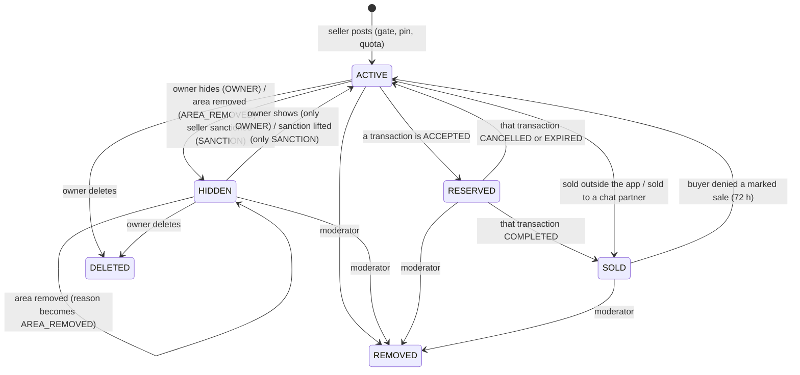
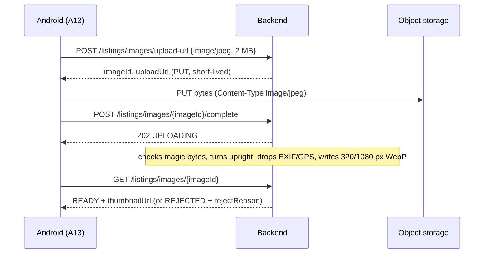

# Listing API contract (Listing + Discovery)

This contract covers SRS section 3.3 (Listing: FR-LS-01..04, 06..14) and section 3.4 (Discovery: FR-DC-01..08, 12), plus the "active listings" part of the public profile (FR-ID-13). The machine-readable contract is [`openapi.yml`](openapi.yml) (tags **Listings**, **Listing images**, **Favorites**, **Discovery**); the Postman collection is [`docs/postman/nearby-listing.postman_collection.json`](../postman/nearby-listing.postman_collection.json).

Not built (by design):
- **R2:** automatic screening and the PENDING_REVIEW queue (FR-LS-05), admin-managed categories (FR-LS-15), search history, keyword alerts and feed category preferences (FR-DC-09..11). FR-DC-13 (personalised suggestions) is out of scope.
- **Waits for other modules:** see [Waits for other modules](#waits-for-other-modules). Some buttons and counters are placeholders until Chat, Transaction, Reputation and Moderation exist.

**Breaking changes:** none; every endpoint is new. One shared change applies to all modules: a query or path value of the wrong type (for example an unknown enum name) and a violated constraint on a query parameter now answer `400 VALIDATION_FAILED` with `errors[]`. Before, they answered a `400` without `code`.

## Conventions

Same as [`identity-api.md` › Conventions](identity-api.md#conventions): base path `/api/v1`, bearer token, RFC 9457 problems with a stable `code`, `Retry-After` on `429`, cursor pages `{items, nextCursor, hasMore}`, and the Idempotency-Key rules.

| Topic | Rule |
|---|---|
| Guests | `GET /feed`, `/search`, `/map/listings`, `/categories`, `/listings/{id}` and `/users/{id}/listings` work without a token. With a token they also use the caller's active area and hide blocked users |
| Locations | The exact pin is returned **only to the owner** (`pin` on the owner's own listing). Everyone else gets `publicPoint`, the center of the ~300 m grid cell that holds the pin (FR-LS-03). Cards carry no coordinates at all, only `distanceMeters` |
| Distances | Rounded to 100 m. Show "900 m" below 1 000 m and "1,0 km" (one decimal) from 1 000 m |
| Optimistic lock | Owner changes that the SRS versions send the `version` from the last response. A newer version on the server: `409 CONCURRENT_MODIFICATION` with `currentVersion`; reload and retry |
| Idempotency-Key | Required on `POST /listings` and `POST /listings/{id}/sold-outside` |
| Prices | Whole VND (`priceVnd`), 0-1 000 000 000. `0` = given away: show "Miễn phí" (`free = true`) |

## Endpoint summary

| # | Method and path | Auth | Success | Requirement |
|---|---|---|---|---|
| 1 | `GET /listings/posting-eligibility` | USER | 200 | UC-LS-01 step 1, FR-ID-20, FR-LS-04 |
| 2 | `POST /listings/images/upload-url` | USER | 200 | FR-LS-02 |
| 3 | `POST /listings/images/{imageId}/complete` | USER | 202 | UC-SY-10 |
| 4 | `GET /listings/images/{imageId}` | USER | 200 | UC-LS-01 A5 |
| 5 | `POST /listings` (Idempotency-Key) | USER | 201 | FR-LS-01..04, UC-LS-01 |
| 6 | `PUT /listings/{listingId}` | USER (owner) | 200 | FR-LS-06, UC-LS-02 |
| 7 | `POST /listings/{listingId}/hide` | USER (owner) | 200 | FR-LS-07, UC-LS-03 |
| 8 | `POST /listings/{listingId}/unhide` | USER (owner) | 200 | FR-LS-07, UC-LS-03 |
| 9 | `POST /listings/{listingId}/sold-outside` (Idempotency-Key) | USER (owner) | 200 | FR-LS-09 (b), UC-LS-05 A1 |
| 10 | `POST /listings/{listingId}/bump` | USER (owner) | 200 | FR-LS-10, UC-LS-06 |
| 11 | `DELETE /listings/{listingId}` | USER (owner) | 204 | FR-LS-08, UC-LS-04 |
| 12 | `GET /listings/me` | USER | 200 | FR-LS-11, UC-LS-07 |
| 13 | `GET /listings/{listingId}` | public | 200 | FR-DC-08, FR-LS-03, FR-LS-14, UC-DC-04 |
| 14 | `PUT /listings/{listingId}/favorite` | USER | 204 | FR-LS-12, UC-LS-08 |
| 15 | `DELETE /listings/{listingId}/favorite` | USER | 204 | FR-LS-12, UC-LS-08 |
| 16 | `GET /users/me/favorites` | USER | 200 | FR-LS-12, UC-LS-09 |
| 17 | `GET /feed` | public | 200 | FR-DC-01, 04, 05, UC-DC-01 |
| 18 | `GET /search` | public | 200 | FR-DC-02..06, UC-DC-02 |
| 19 | `GET /map/listings` | public | 200 | FR-DC-07, UC-DC-03 |
| 20 | `GET /categories` | public | 200 | A08, A12 |
| 21 | `GET /users/{userId}/listings` | public | 200 | FR-ID-13 (A11) |
| — | `GET /users/me/trading-gate` | USER | 200 | FR-ID-20 (see [identity F15](identity-api.md#f15-trading-gate-before-posting-chatting-or-making-an-offer-fr-id-20-uc-ls-01--uc-ch-01--uc-tx-01-a06-a10-a12)) |

Every endpoint can return `400 VALIDATION_FAILED`; secured ones `401 UNAUTHENTICATED`. Another user's listing on an owner endpoint, and a listing the caller may not see, answer `404 LISTING_NOT_FOUND` (FR-ID-18).

## Listing lifecycle (SRS table `tab:sm-listing`, R1 rows)



Any other move answers `409 INVALID_LISTING_STATE` with `status`. Hiding, deleting or changing the price of a RESERVED listing answers `409 LISTING_HAS_OPEN_TRANSACTIONS` with the holding `transactionId`. SOLD, REMOVED and DELETED listings cannot be edited. Who sees what:

| Status | Feed, search, map | Detail | "Tin của tôi" | Label on cards |
|---|---|---|---|---|
| ACTIVE | yes | everyone | yes | — |
| RESERVED | yes | everyone | yes | "Đã đặt" |
| SOLD | search with `includeSold=true` only | everyone | yes | "Đã bán" |
| HIDDEN | no | owner only | yes, with `hiddenReason` | — |
| REMOVED | no | owner only | yes | "Đã gỡ" |
| DELETED | no | nobody (404) | no | — |

Limits a seller meets:

| Rule | Value (`app_parameters`) |
|---|---|
| New listings | 3 per rolling 24 h until the first completed transaction (`listing.new_account_daily_limit`); deleted listings still count |
| Open listings (ACTIVE + RESERVED + PENDING_REVIEW) | 30 (`listing.max_open_per_user`) |
| Images | 1-10 per listing (`listing.max_images`), JPEG/PNG/WebP up to 5 242 880 bytes (`image.max_bytes`); HEIC: convert to JPEG in the app |
| Pin | Within 1 500 m of the chosen area's center (`listing.pin_radius_m`); blurred to a 300 m grid (`listing.blur_m`) |
| Bump | Once per 48 h (`listing.bump_cooldown_hours`), 10 times per listing (`listing.bump_max_per_listing`) |
| Fields | Title 5-100 characters, description ≤ 2 000 (line breaks kept), meeting spot ≤ 100; control characters are removed |

---

## Business flows per screen

Rules for every flow: branch on `code`, never on `detail`. For `429`, disable the action and count down from `Retry-After`. Field errors come as `errors: [{field, message}]`: show each under its field.

### FL1. Post a listing (UC-LS-01; A06 "Đăng tin" → A12 → A13)

| Step | Screen / action | API | Success | Errors and UI |
|---|---|---|---|---|
| 1 | Tap "Đăng tin" | `GET /listings/posting-eligibility` | `canPost = true`: open A12 and show "Còn {remainingToday} tin hôm nay" when `remainingToday` is not null | `canPost = false`: if `gateFailures` is not empty, show the trading-gate call to action ([identity F15](identity-api.md#f15-trading-gate-before-posting-chatting-or-making-an-offer-fr-id-20-uc-ls-01--uc-ch-01--uc-tx-01-a06-a10-a12)); if `remainingToday = 0` "Bạn đã đăng 3 tin hôm nay"; if `remainingOpen = 0` "Bạn đang có 30 tin mở" |
| 2 | A12 opens; load categories once | `GET /categories` | Fill the category picker with `name`, keep `id` | — |
| 3 | A13: for each picked photo (1-10), in order | `POST /listings/images/upload-url` `{contentType, sizeBytes}` | Keep `imageId`; `PUT` the bytes to `uploadUrl` with header `Content-Type: {contentType}` | `400 INVALID_IMAGE`: wrong type (convert HEIC to JPEG first) or over 5 MB. Upload URL expired (`expiresAt`): ask a new one |
| 4 | After each `PUT` | `POST /listings/images/{imageId}/complete` | `202`, `status = UPLOADING`: show a spinner on that photo | `400 INVALID_IMAGE`: nothing uploaded or too large; upload again. `404 IMAGE_NOT_FOUND` |
| 5 | Poll each photo every 1-2 s until it settles | `GET /listings/images/{imageId}` | `READY`: show `thumbnailUrl` | `REJECTED` with `rejectReason` (`TYPE_MISMATCH`, `UNSUPPORTED_TYPE`, `TOO_LARGE`, `DECODE_ERROR`): "Ảnh không hợp lệ, hãy chọn ảnh khác". The user can keep editing while photos process (A5) |
| 6 | A12: title, description, category, condition, price (or "Cho tặng miễn phí" = 0), "Nhận đề nghị giá", meeting spot; pick the area (from `GET /areas/me`, VERIFIED or EXPIRING) and move the pin inside the 1 500 m circle (A13 shows the 300 m blur circle) | — | — | Validate the field rules locally for early feedback |
| 7 | "Đăng tin": new `key = UUID` | `POST /listings` + `Idempotency-Key: key`, `imageIds` in display order (first = cover) | `201`: open the detail of `id` (FL7) | `403 TRADING_GATE_FAILED`: show `reasons` (F15). `422 PIN_OUTSIDE_AREA`: "Ghim phải nằm trong khu vực đã xác minh"; move the pin. `422 IMAGE_INVALID`: an image is not READY or already used; re-upload it. `422 CATEGORY_INACTIVE`: reload categories. `429 LISTING_DAILY_LIMIT` (`remaining`, `dailyLimit`, `Retry-After`). `409 LISTING_OPEN_LIMIT`. `400 VALIDATION_FAILED`: field errors. Network error: resend **the same body with the same key** (A4) |

Keep between steps: `imageId`s in display order, `key` until the post gets any HTTP answer. Images that are never posted are deleted by the server after 24 h.



### FL2. Edit a listing (UC-LS-02; A14 → A12)

| Step | Screen / action | API | Success | Errors and UI |
|---|---|---|---|---|
| 1 | A14 "Sửa": open A12 filled from the owner view | `GET /listings/{id}` (owner gets `pin`, `version`) | Fill the form | `404`: refresh A14 |
| 2 | Upload new photos as in FL1 steps 3-5 | — | — | — |
| 3 | "Lưu": send the whole form with `version`; the area cannot change | `PUT /listings/{id}` | `200`: new `version` | `409 CONCURRENT_MODIFICATION`: "Tin đã được thay đổi ở nơi khác", reload. `409 INVALID_LISTING_STATE`: SOLD/REMOVED/DELETED cannot be edited. `409 LISTING_HAS_OPEN_TRANSACTIONS`: the price of a RESERVED listing cannot change. `422 PIN_OUTSIDE_AREA`, `IMAGE_INVALID`, `CATEGORY_INACTIVE` as in FL1 |

Disable the price field while `status = RESERVED`. Hide "Sửa" for SOLD and REMOVED.

### FL3. Manage my listings (UC-LS-03, 04, 05 A1, 06, 07; A14)

| Step | Screen / action | API | Success | Errors and UI |
|---|---|---|---|---|
| 1 | Open A14; tabs "Đang bán" (`ACTIVE`, `RESERVED`), "Đã ẩn" (`HIDDEN`), "Đã bán" (`SOLD`), "Bị gỡ" (`REMOVED`) | `GET /listings/me?status=ACTIVE&status=RESERVED` | Tab badges from `countsByStatus`; rows with `views`, `chats`, `favorites`, `openOffers`; keep `version` per row | Empty group: "Bạn chưa có tin nào" with "Đăng tin" (FL1) |
| 2 | "Ẩn" on an ACTIVE row | `POST /listings/{id}/hide` `{version}` | Move the row to "Đã ẩn" | `409 LISTING_HAS_OPEN_TRANSACTIONS`: "Tin đang được giữ cho một giao dịch" (`transactionId`). `409 CONCURRENT_MODIFICATION`: reload |
| 3 | "Hiện" on a HIDDEN row with `hiddenReason = OWNER` | `POST /listings/{id}/unhide` `{version}` | Back to "Đang bán" | `409 INVALID_LISTING_STATE` with `hiddenReason`: `AREA_REMOVED` "Khu vực của tin đã bị xoá", `SANCTION` "Tài khoản đang bị hạn chế" |
| 4 | "Đẩy tin" on an ACTIVE row | `POST /listings/{id}/bump` | Show "Tin đã lên đầu bảng tin"; next allowed at `nextBumpAllowedAt` | `429 BUMP_TOO_SOON` (`nextAllowedAt`, `Retry-After`). `409 BUMP_LIMIT_REACHED`: hide the button |
| 5 | "Đã bán" → "Bán cho người ngoài ứng dụng" (ACTIVE only); new `key` | `POST /listings/{id}/sold-outside` `{version}` + `Idempotency-Key` | Move to "Đã bán" | `409 INVALID_LISTING_STATE`: not ACTIVE. Selling to a chat partner comes with the Transaction module |
| 6 | "Xoá" (confirm "Tin sẽ không còn hiển thị") | `DELETE /listings/{id}` | `204`: remove the row | `409 LISTING_HAS_OPEN_TRANSACTIONS`: finish or cancel it first. `409 INVALID_LISTING_STATE`: SOLD or REMOVED cannot be deleted |

Show "Ẩn", "Đẩy tin", "Đã bán" only for ACTIVE; "Hiện" only for HIDDEN with `hiddenReason = OWNER`; "Xoá" for ACTIVE and HIDDEN.

### FL4. Nearby feed (UC-DC-01; A06)

| Step | Screen / action | API | Success | Errors and UI |
|---|---|---|---|---|
| 1 | Signed in with an active area | `GET /feed` | 20 cards newest/bumped first; keep `nextCursor` | — |
| 1' | Guest, or browsing elsewhere: GPS (only when the user taps "Dùng vị trí hiện tại", LG-02) or a point picked on the map | `GET /feed?lat=..&lon=..&rangeLevel=MEDIUM` | As above | `400 VALIDATION_FAILED` on `center`: no center; ask to pick a point. `400 INVALID_RANGE` |
| 2 | Scroll to the end while `hasMore` | `GET /feed?cursor={nextCursor}` (same lat/lon) | Append; no repeats even when new listings arrive | `400 INVALID_CURSOR`: reload from step 1 |
| 3 | Pull to refresh | step 1 again, without cursor | — | — |

Empty first page: "Chưa có tin nào gần bạn" with "Mở rộng phạm vi" (change the range level, area flow FA4). Range NEAR/MEDIUM/FAR = 2/4/6 km.

### FL5. Search with filters and sort (UC-DC-02; A07, A08)

| Step | Screen / action | API | Success | Errors and UI |
|---|---|---|---|---|
| 1 | Type a keyword; open filters: category, price range, condition, free only, radius 1-20 km, include sold, sort | `GET /search?q=ao khoac&categoryId=4&minPrice=0&maxPrice=500000&condition=LIKE_NEW&freeOnly=false&radiusKm=5&includeSold=false&sort=NEAREST` (+ `lat`/`lon` for a picked point) | Cards and filter chips; `radiusMeters` is the radius used | `400 VALIDATION_FAILED`: `minPrice` above `maxPrice`, unknown `categoryId` or `sort`; show under the filter. `429 RATE_LIMITED` (not enforced yet, X-W3): wait for `Retry-After` |
| 2 | `radiusAdjusted = true` | — | Toast "Bán kính đã được điều chỉnh về {radiusMeters/1000} km" | — |
| 3 | No result and `suggestWiderRadius = true` | — | "Mở rộng bán kính" button: repeat with a bigger `radiusKm` | — |
| 4 | Next page | same query + `cursor` | Append | `400 INVALID_CURSOR`: the cursor belongs to another sort; restart |

Accents and case are ignored ("ao khoac" finds "Áo khoác"). Sort `RELEVANT` = 0,5 × proximity + 0,3 × seller reputation + 0,2 × freshness (weights `search.rank_weights`). Keep every filter unchanged while paging. "Xem trên bản đồ" opens FL6 with the same filters.

### FL6. Map (UC-DC-03; A09)

| Step | Screen / action | API | Success | Errors and UI |
|---|---|---|---|---|
| 1 | Map moved or zoomed (debounce ~300 ms) | `GET /map/listings?south=..&west=..&north=..&east=..&zoom=14` (+ `categoryId`, `minPrice`, `maxPrice`, `freeOnly`) | `points` not empty: one marker per listing at `location` (blurred). `clusters` not empty: a bubble with `listings` at `center`; tap zooms in | `400 VALIDATION_FAILED`: viewport or zoom |
| 2 | Tap a marker | FL7 with `listingId` | — | — |

A response never holds both points and clusters, and never more than 200 of them.

### FL7. Listing detail (UC-DC-04; A10)

| Step | Screen / action | API | Success | Errors and UI |
|---|---|---|---|---|
| 1 | Open a card | `GET /listings/{id}` (+ `lat`/`lon` when the list used a picked point) | 1080 px `images`, attributes, mini map at `publicPoint` with a ~300 m circle, `distanceMeters`, seller card, counters; the view is counted once per viewer per day | `404 LISTING_NOT_FOUND`: "Tin không còn tồn tại"; drop it from local lists |
| 2 | Seller name and avatar | `GET /users/{seller.id}` | Show name, avatar, `seller.tier` | — |
| 3 | Buttons from `actions` | — | `enabled = true`: active button. `ownListing = true`: show "Sửa", "Ẩn", "Đẩy tin" (FL2/FL3) instead of Chat/Offer | `enabled = false`: show `reason`: `LOGIN_REQUIRED` → login screen; `TRADING_GATE_FAILED` → F15 with `gateFailures`; `LISTING_AREA_EXPIRED` "Người bán cần gia hạn khu vực"; `OUT_OF_RANGE` "Tin nằm ngoài khu vực của bạn" (area FA5); `LISTING_NOT_AVAILABLE` "Tin không còn nhận liên hệ"; `OWN_LISTING` |
| 4 | Heart | `PUT` / `DELETE /listings/{id}/favorite` | Toggle `savedByViewer`; update the count locally | `404`: the listing is gone |

Chat and Offer act only when the Chat and Transaction modules exist (register LS-W8); until then show the buttons with their states but route a tap to "Sắp ra mắt".

### FL8. Saved listings (UC-LS-09; A15)

| Step | Screen / action | API | Success | Errors and UI |
|---|---|---|---|---|
| 1 | Open A15 | `GET /users/me/favorites` (+ `cursor`) | Newest saved first. `available = false`: grey out with "Không còn khả dụng" and disable opening | `400 INVALID_CURSOR`: reload |
| 2 | Remove | `DELETE /listings/{listingId}/favorite` | `204`, remove the row | — |

### FL9. A seller's listings on the public profile (FR-ID-13; A11)

`GET /users/{userId}` ([identity](identity-api.md)) for the header, then `GET /users/{userId}/listings` (+ `cursor`, `limit`) for ACTIVE and RESERVED cards, newest first. Between users who blocked each other the list is empty.

---

## Endpoint details

### 1. `GET /listings/posting-eligibility`

```json
{"canPost": true, "gateFailures": [], "remainingToday": 2, "dailyLimit": 3, "remainingOpen": 29, "maxOpenListings": 30}
```

`remainingToday` is `null` once the seller has a completed transaction (no daily limit). `gateFailures` values: `ACCOUNT_RESTRICTED`, `PHONE_NOT_VERIFIED`, `NO_VALID_AREA`, `AREA_EXPIRED`, `CONSENT_MISSING`.

### 2. `POST /listings/images/upload-url`

Request `{"contentType": "image/jpeg", "sizeBytes": 2048000}`; `contentType` is `image/jpeg`, `image/png` or `image/webp`; `sizeBytes` 1-5 242 880.

```json
{"imageId": "6f1c…", "uploadUrl": "https://storage…/incoming/…?X-Amz-…", "uploadMethod": "PUT", "contentType": "image/jpeg", "expiresAt": "2026-11-22T03:10:00Z", "maxSizeBytes": 5242880}
```

| Status | `code` | When | UI |
|---|---|---|---|
| 400 | `INVALID_IMAGE` | Another type (GIF, HEIC…) or over the limit | Pick or convert another photo |

### 3. `POST /listings/images/{imageId}/complete` and 4. `GET /listings/images/{imageId}`

Both answer the image status (3 with `202`, 4 with `200`):

```json
{"imageId": "6f1c…", "status": "READY", "thumbnailUrl": "https://storage…/listing-images/6f1c…_320.webp?X-Amz-…"}
```

`status`: `UPLOADING` (processing), `READY`, `REJECTED` (+ `rejectReason`: `TYPE_MISMATCH`, `UNSUPPORTED_TYPE`, `TOO_LARGE`, `DECODE_ERROR`). The server checks the real type from the bytes, turns the photo upright, removes EXIF/GPS and writes 320 px and 1080 px WebP copies; the original is never served. Calling 3 again after processing returns the current status.

| Status | `code` | When | UI |
|---|---|---|---|
| 400 | `INVALID_IMAGE` | (3) Nothing uploaded yet, or the object is over 5 MB (it is deleted) | Upload again |
| 404 | `IMAGE_NOT_FOUND` | Not the caller's image | — |

### 5. `POST /listings` (Idempotency-Key)

```json
{
  "areaId": "0b6e…",
  "title": "Áo khoác da nam",
  "description": "Còn mới 90%, size L",
  "condition": "LIKE_NEW",
  "priceVnd": 150000,
  "acceptOffers": true,
  "meetingSpot": "Cổng KTX khu A",
  "categoryId": 4,
  "latitude": 10.87,
  "longitude": 106.80,
  "imageIds": ["6f1c…", "91aa…"]
}
```

| Field | Type | Rules |
|---|---|---|
| `areaId` | UUID, required | One of the caller's VERIFIED or EXPIRING areas; never changes |
| `title` | string, required | 5-100 characters after removing control characters |
| `description` | string | ≤ 2 000 characters |
| `condition` | enum, required | `NEW`, `LIKE_NEW`, `USED`, `WORN` |
| `priceVnd` | integer, required | 0-1 000 000 000 |
| `acceptOffers` | boolean | Default `true`; `false` means offers must equal the price |
| `meetingSpot` | string | ≤ 100 characters |
| `categoryId` | integer, required | An active id from `GET /categories` |
| `latitude`, `longitude` | number, required | The exact pin, within 1 500 m of the area center; private |
| `imageIds` | UUID[], required | 1-10 READY images of the caller, not used by another listing; order = display order |

`201` with `Location: /api/v1/listings/{id}` and the owner view:

```json
{
  "id": "c3d2…", "status": "ACTIVE", "categoryId": 4, "areaId": "0b6e…",
  "title": "Áo khoác da nam", "description": "Còn mới 90%, size L", "condition": "LIKE_NEW",
  "priceVnd": 150000, "free": false, "acceptOffers": true, "meetingSpot": "Cổng KTX khu A",
  "pin": {"latitude": 10.87, "longitude": 106.80},
  "publicPoint": {"latitude": 10.8701, "longitude": 106.8013},
  "localityName": null,
  "images": [{"id": "6f1c…", "position": 1, "thumbnailUrl": "…_320.webp?…", "largeUrl": "…_1080.webp?…"}],
  "views": 0, "favorites": 0, "chats": 0, "bumpCount": 0,
  "publishedAt": "2026-11-22T03:00:00Z", "createdAt": "2026-11-22T03:00:00Z", "updatedAt": "2026-11-22T03:00:00Z",
  "version": 0
}
```

Absent when null: `hiddenReason`, `description`, `meetingSpot`, `bumpedAt`, `nextBumpAllowedAt`, `soldAt`. `localityName` is `null` until the neighbourhood source is settled (register X-W1).

| Status | `code` | When | UI |
|---|---|---|---|
| 400 | `VALIDATION_FAILED` | A field rule, an unknown `categoryId`, 0 or 11 images, the same image twice | Show `errors[]` |
| 400 | `IDEMPOTENCY_KEY_REQUIRED` | Header missing or not a UUID | App bug |
| 403 | `TRADING_GATE_FAILED` | `reasons` lists the unmet conditions | F15 call to action |
| 409 | `LISTING_OPEN_LIMIT` | Already 30 open listings (`maxOpenListings`) | "Ẩn, xoá hoặc bán bớt tin" |
| 409 | `IDEMPOTENCY_CONFLICT` / `DUPLICATE_REQUEST` | Same key, other body / still running | New key / wait |
| 422 | `PIN_OUTSIDE_AREA` | The area is not a valid area of the caller, or the pin is more than 1 500 m from its center | Move the pin |
| 422 | `IMAGE_INVALID` | An image is not the caller's, not READY, or used by another listing | Re-upload |
| 422 | `CATEGORY_INACTIVE` | The category was retired | Reload categories |
| 429 | `LISTING_DAILY_LIMIT` | 4th listing in 24 h before the first completed transaction; `remaining`, `dailyLimit`, `Retry-After` | Count down |

Side effects: `ListingPublished`.

### 6. `PUT /listings/{listingId}`

The same fields as 5 without `areaId`, plus `version` (required). A moved pin must stay within 1 500 m of the listing's area. Images left out are released (deleted by the server after 24 h). `200` with the owner view (new `version`).

| Status | `code` | When | UI |
|---|---|---|---|
| 404 | `LISTING_NOT_FOUND` | Not the caller's listing, or deleted | Refresh |
| 409 | `CONCURRENT_MODIFICATION` | `version` is stale; `currentVersion` | Reload |
| 409 | `INVALID_LISTING_STATE` | SOLD, REMOVED or DELETED | — |
| 409 | `LISTING_HAS_OPEN_TRANSACTIONS` | Price change while RESERVED; `transactionId` | Keep the old price |
| 422 | `PIN_OUTSIDE_AREA`, `IMAGE_INVALID`, `CATEGORY_INACTIVE` | As in 5 (`CATEGORY_INACTIVE` only for a changed category) | As in 5 |

Side effects: `ListingPriceDropped` when the price of an ACTIVE listing goes down.

### 7-9. `POST /listings/{id}/hide`, `/unhide`, `/sold-outside`

Body `{"version": 3}`; `sold-outside` also needs `Idempotency-Key`. `200` with the owner view.

| Status | `code` | When |
|---|---|---|
| 404 | `LISTING_NOT_FOUND` | Not the caller's listing |
| 409 | `CONCURRENT_MODIFICATION` | Stale `version` |
| 409 | `INVALID_LISTING_STATE` | hide: not ACTIVE. unhide: not HIDDEN, or `hiddenReason` is `AREA_REMOVED` / `SANCTION` (returned). sold-outside: not ACTIVE |
| 409 | `LISTING_HAS_OPEN_TRANSACTIONS` | hide of a RESERVED listing; `transactionId` |

Side effects: `ListingStatusChanged`.

### 10. `POST /listings/{id}/bump`

No body. `200` with the owner view (`bumpCount`, `bumpedAt`, `nextBumpAllowedAt`). The listing moves above every listing posted or bumped before.

| Status | `code` | When |
|---|---|---|
| 409 | `INVALID_LISTING_STATE` | Not ACTIVE |
| 409 | `BUMP_LIMIT_REACHED` | 10 bumps done (`maxBumps`) |
| 429 | `BUMP_TOO_SOON` | Within 48 h of the last bump; `nextAllowedAt`, `Retry-After` |

### 11. `DELETE /listings/{id}`

`204`. The listing is gone for everyone (`404`), its exact pin is discarded, and its images are deleted by the hourly cleanup (at the latest 25 hours after they were uploaded); conversations about it stay readable.

| Status | `code` | When |
|---|---|---|
| 409 | `LISTING_HAS_OPEN_TRANSACTIONS` | An OFFERED or ACCEPTED transaction, or RESERVED; `transactionId` |
| 409 | `INVALID_LISTING_STATE` | SOLD or REMOVED |

### 12. `GET /listings/me?status=…&cursor=…&limit=…`

`status` is repeatable; default: every state but DELETED. Newest first.

```json
{
  "countsByStatus": {"PENDING_REVIEW": 0, "ACTIVE": 3, "RESERVED": 1, "SOLD": 5, "HIDDEN": 1, "REMOVED": 0},
  "items": [{"id": "c3d2…", "status": "ACTIVE", "title": "Áo khoác da nam", "priceVnd": 150000, "free": false,
             "coverThumbnailUrl": "…_320.webp?…", "views": 12, "chats": 0, "favorites": 2, "openOffers": 0,
             "createdAt": "2026-11-22T03:00:00Z", "version": 1}],
  "nextCursor": null, "hasMore": false
}
```

`coverThumbnailUrl` may be absent (placeholder). `hiddenReason` is present for HIDDEN rows. Errors: `400 INVALID_CURSOR`, `400 VALIDATION_FAILED` (unknown `status`).

### 13. `GET /listings/{id}?lat=…&lon=…`

Public. `lat`/`lon` (both or neither) is where `distanceMeters` is measured from; without them, the caller's active area; a guest without them gets no distance.

```json
{
  "id": "c3d2…", "status": "ACTIVE", "categoryId": 4, "title": "Áo khoác da nam", "description": "Còn mới 90%",
  "condition": "LIKE_NEW", "priceVnd": 150000, "free": false, "acceptOffers": true, "meetingSpot": "Cổng KTX khu A",
  "images": [{"id": "6f1c…", "position": 1, "thumbnailUrl": "…", "largeUrl": "…"}],
  "publicPoint": {"latitude": 10.8701, "longitude": 106.8013},
  "distanceMeters": 1200, "localityName": null,
  "seller": {"id": "5a7e…", "tier": "NEW"},
  "views": 12, "favorites": 2, "savedByViewer": false, "postedAt": "2026-11-22T03:00:00Z",
  "actions": {
    "ownListing": false,
    "chat":   {"enabled": true,  "gateFailures": []},
    "offer":  {"enabled": false, "reason": "TRADING_GATE_FAILED", "gateFailures": ["AREA_EXPIRED"]},
    "save":   {"enabled": true,  "gateFailures": []},
    "report": {"enabled": true,  "gateFailures": []}
  },
  "version": 1
}
```

`pin` and `hiddenReason` appear only for the owner. `seller.score` is absent until the seller has a score (ranked as 50). `reason` values: `LOGIN_REQUIRED`, `OWN_LISTING`, `LISTING_NOT_AVAILABLE` (Chat needs ACTIVE or RESERVED, Offer needs ACTIVE), `TRADING_GATE_FAILED`, `LISTING_AREA_EXPIRED`, `OUT_OF_RANGE`.

| Status | `code` | When |
|---|---|---|
| 404 | `LISTING_NOT_FOUND` | DELETED; REMOVED or HIDDEN for anyone but the owner; between users who blocked each other |
| 400 | `VALIDATION_FAILED` | `lat`/`lon` out of range |

### 14-16. Favourites

`PUT /listings/{id}/favorite` and `DELETE /listings/{id}/favorite`: `204`, idempotent; the listing's `favorites` counter moves by exactly one per user. `PUT` on a listing the caller cannot see: `404 LISTING_NOT_FOUND`. `DELETE` works on listings that are gone.

`GET /users/me/favorites` (cursor page):

```json
{"items": [{"listingId": "c3d2…", "title": "Áo khoác da nam", "priceVnd": 150000, "free": false, "status": "SOLD",
            "available": true, "coverThumbnailUrl": "…", "savedAt": "2026-11-22T03:05:00Z"}],
 "nextCursor": null, "hasMore": false}
```

`available = false` for HIDDEN, REMOVED and DELETED listings.

### 17-18. `GET /feed` and `GET /search`

| Parameter | Feed | Search | Rules |
|---|---|---|---|
| `lat`, `lon` | yes | yes | Both or neither; neither = the caller's active area (guests must send them) |
| `rangeLevel` | yes | yes | `NEAR` 2 km, `MEDIUM` 4 km (default), `FAR` 6 km; only with `lat`/`lon` |
| `q` | — | yes | ≤ 100 characters; accents and case ignored |
| `categoryId`, `minPrice`, `maxPrice`, `condition` (repeatable), `freeOnly` | — | yes | `minPrice ≤ maxPrice` |
| `radiusKm` | — | yes | Default: the center's range; outside 1-20 is clamped |
| `includeSold` | — | yes | Default `false` |
| `sort` | — | yes | `NEWEST` (default), `NEAREST`, `RELEVANT` |
| `cursor` | yes | yes | `nextCursor` of the previous page of the same query |

```json
{
  "items": [{"id": "c3d2…", "title": "Áo khoác da nam", "priceVnd": 150000, "free": false, "status": "ACTIVE",
             "coverThumbnailUrl": "…_320.webp?…", "distanceMeters": 900, "postedAt": "2026-11-22T03:00:00Z",
             "sellerTier": "NEW"}],
  "nextCursor": "djF8TkVXRVNU…", "hasMore": true,
  "radiusMeters": 4000, "radiusAdjusted": false, "suggestWiderRadius": false
}
```

Only ACTIVE and RESERVED listings (and SOLD with `includeSold=true`) within the radius of their public point; sellers the caller blocked, or who blocked the caller, are left out. 20 per page (`search.page_size`).

| Status | `code` | When |
|---|---|---|
| 400 | `VALIDATION_FAILED` | `center` (no center), `lat`/`lon` (only one sent), `minPrice`, `categoryId`, `sort`, `condition` |
| 400 | `INVALID_RANGE` | `rangeLevel` |
| 400 | `INVALID_CURSOR` | Undecodable cursor, or one from another sort |

### 19. `GET /map/listings?south=…&west=…&north=…&east=…&zoom=…`

Required: the viewport (`south < north`, `west < east`) and `zoom` 0-22. Optional: `categoryId`, `minPrice`, `maxPrice`, `freeOnly`.

```json
{"points": [{"listingId": "c3d2…", "priceVnd": 150000, "status": "ACTIVE", "location": {"latitude": 10.8701, "longitude": 106.8013}}],
 "clusters": []}
```

or, with more than 200 listings in view, `{"points": [], "clusters": [{"listings": 37, "center": {"latitude": 10.86, "longitude": 106.79}}]}` (at most 200 clusters). Every location is a blurred public point.

### 20. `GET /categories`

```json
[{"id": 1, "code": "ELECTRONICS", "name": "Đồ điện tử"}, {"id": 2, "code": "HOUSEHOLD", "name": "Đồ gia dụng"}]
```

Codes: `ELECTRONICS`, `HOUSEHOLD`, `BOOKS`, `FASHION`, `VEHICLES`, `BABY`, `SPORTS`, `FREE_SHARING`, `OTHER`, in display order. `iconKey` is absent until icons are set.

### 21. `GET /users/{userId}/listings?cursor=…&limit=…`

Cursor page of result cards (no `distanceMeters`), ACTIVE and RESERVED, newest first.

---

## Domain events and module public API

| Event | When | Consumers |
|---|---|---|
| `ListingPublished` | A listing is posted | Discovery keyword alerts (R2) |
| `ListingPriceDropped` | The price of an ACTIVE listing goes down | Notification to favouriters (R2) |
| `ListingStatusChanged` (`fromStatus`, `toStatus`) | Any state change | Transaction (reject open offers on SOLD/REMOVED), Notification (R2) |

Listing reacts to `AreaRemoved` (hide with `AREA_REMOVED`), `UserSanctioned` / `SanctionLifted` (hide / restore with `SANCTION`) and `AccountDeleted` (favourites deleted, listings DELETED without their pins).

For other backend modules: facades `ListingLookup`, `ListingReservations`, `ListingCounters`, `SellerScores`, `ListingModeration`; SPIs `OpenTransactionCheck`, `SellerTradeHistory`, `OpenOfferCounts` (implemented by Transaction).

## Waits for other modules

What the app sees until the named module is built (register in the backend status file):

| What | Until then | Comes with |
|---|---|---|
| "Đã bán" → pick a chat partner, buyer confirms or denies within 72 h (FR-LS-09 a) | Only "Bán cho người ngoài ứng dụng" | Transaction |
| RESERVED state and its refusals | Never happens | Transaction |
| Deleting while an offer is open is refused | Never refused | Transaction |
| `openOffers` (A14), `chats` (A14, detail) | 0 | Transaction, Chat |
| Daily limit lifted after the first completed transaction | Always 3 per 24 h | Transaction |
| `sellerTier` / `seller.score`; `RELEVANT` reputation part | `NEW`, no score (ranked as 50) | Reputation |
| Chat, Offer, Report buttons act | States and reasons only | Chat, Transaction, Moderation |
| Moderator removal (REMOVED) | Never happens | Moderation |
| `localityName` | `null` | Area follow-up |
| `429 RATE_LIMITED` on search (global limit per IP and user, `tab:ratelimits`) | Not enforced yet; handle it anyway (wait for `Retry-After`) | Platform (X-W3) |

## Runtime parameters

| Key | Default | Used for |
|---|---|---|
| `listing.blur_m` | 300 | Public point grid |
| `listing.pin_radius_m` | 1500 | Pin distance from the area center |
| `listing.max_images` | 10 | Images per listing |
| `listing.max_open_per_user` | 30 | Open listings |
| `listing.new_account_daily_limit` | 3 | Listings per 24 h before the first completed transaction |
| `listing.bump_cooldown_hours`, `listing.bump_max_per_listing` | 48, 10 | Bumps |
| `image.max_bytes` (`upload.max_image_mb`) | 5 242 880 (5) | Image size |
| `upload.orphan_ttl_hours` | 24 | Unused uploads are deleted after |
| `search.max_radius_km`, `search.page_size` | 20, 20 | Search radius cap, page size |
| `search.rank_weights` | 0.5,0.3,0.2 | `RELEVANT` sort |

## Background jobs

| Job | Schedule | Effect |
|---|---|---|
| Orphan image cleanup (UC-SY-15) | Hourly | Deletes images not attached to a listing 24 h after their upload started, and the images of deleted listings |
